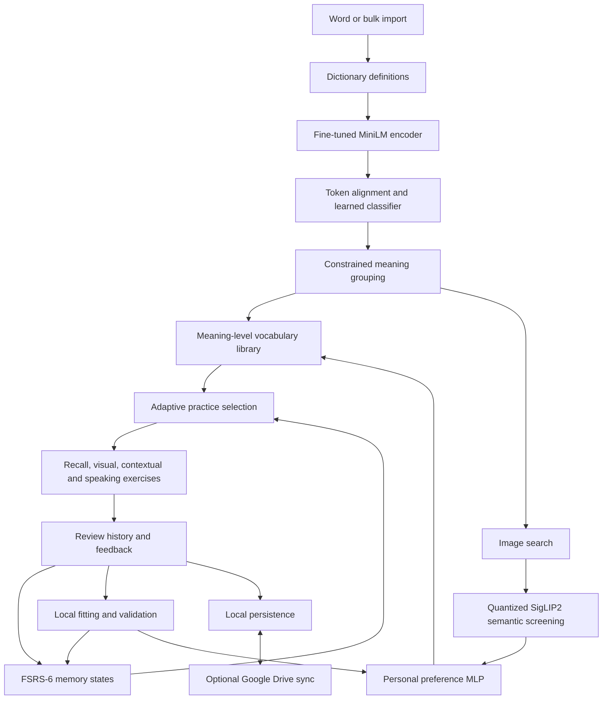
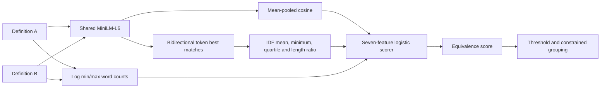

<div align="center">

# KeepVocab

### On-device NLP, multimodal learning and personalized memory modeling

A cross-platform vocabulary learning application that uses **fine-tuned semantic models**, quantized vision-language inference and adaptive spaced repetition to turn dictionary entries into personalized learning material.

[](https://www.python.org/)
[](https://pytorch.org/)
[](https://huggingface.co/)
[](https://onnxruntime.ai/)
[](https://developer.mozilla.org/en-US/docs/Web/JavaScript)
[](https://www.electronjs.org/)
[](https://capacitorjs.com/)
[](https://github.com/RODIONOLIINYK/KeepVocab/releases)

**Local-first · Model experimentation · Edge inference · Feedback-driven personalization**

| Definition-pair dataset | Validation recall | Validation F1 | FP16 encoder |
| :---: | :---: | :---: | :---: |
| **5,564 pairs** | **80.09%** | **0.700** | **45.3 MB** |

Results for the v8 definition-equivalence model at a validation-selected threshold. On the 642-pair test cohort: **72.25% recall, 57.50% precision, 0.640 F1**. Labels are agent-reviewed, and the test cohort has been inspected repeatedly.

[ML research](#1-definition-equivalence-nlp) · [Architecture](#architecture) · [Technology stack](#technology-stack) · [Download application](https://github.com/RODIONOLIINYK/KeepVocab/releases)

</div>

---

## Why this project stands out

KeepVocab is a working vocabulary application and an applied ML research project. Instead of using an LLM for every decision, it combines task-specific models that can run locally on consumer devices:

- **NLP:** fine-tune a compact Transformer to recognize equivalent dictionary definitions, then develop and evaluate a lightweight token-alignment classifier.
- **Computer vision:** use quantized vision-language embeddings to filter images by meaning; train a separate preference MLP from feedback.
- **Memory modeling:** adapt FSRS-6 parameters and recall probabilities from dated review histories, with validation gates before adopting new weights.
- **Edge deployment:** export learned models to ONNX, verify inference behavior, optimize asset size and integrate background workers into the same web, macOS and Android application.

## Architecture



## 1. Definition equivalence (NLP)

### Problem formulation

A dictionary may return several paraphrases of the same sense, while two definitions with almost identical words can describe genuinely distinct meanings. Generic sentence similarity is not sufficient: the task is binary **semantic equivalence**, within the vocabulary of a headword, under a strict model-size constraint.

The model predicts whether two definitions should be grouped. The application preserves part-of-speech constraints, source definitions and explicit user judgments, using complete-linkage grouping rather than blindly merging every connected pair.

### Dataset engineering

The training data consists of dictionary-derived definition pairs, labeled equivalent or distinct. The data pipeline records extraction receipts, source-definition hashes, sense IDs and headword families; examples without sufficient provenance are excluded. Splits are constructed to prevent exact overlap in headwords, families, definitions and source identities.

| Dataset version | Training | Validation | Test |
|---|---:|---:|---:|
| v7 | 2,722 | 390 | 384 |
| v8 | 4,266 | 656 | 642 |

The v7 training set contained 674 positive and 2,048 negative pairs. Class imbalance was handled in the objective rather than evaluated using accuracy alone. The v8 model card records one cross-split near-duplicate despite exact disjointness; labels are agent-reviewed rather than independently human-verified.

### Model evolution and experimental results

The research compared compact neural classifiers, sentence-level embeddings and token-level interaction. An important finding was that increasing classifier capacity or combining regularization techniques did not necessarily improve generalization.

The following results come from the historical v6/v7 ablation report. These variants share the 390-pair validation and 384-pair test cohorts; some use expanded training data.

| Experiment | Validation PR-AUC | Test PR-AUC | Test F1 |
|---|---:|---:|---:|
| 1,153D Siamese MLP baseline | 0.6648 | 0.6731 | 0.6038 |
| Siamese MLP + early stopping | 0.6846 | 0.6801 | 0.6067 |
| Siamese MLP + 16D bottleneck | 0.6098 | 0.6327 | 0.5751 |
| Siamese MLP + all regularizers | 0.6754 | 0.6763 | 0.5874 |
| Token-alignment scorer, unmasked/uniform control | 0.7078 | 0.7056 | 0.6220 |
| Prefix masking + IDF weighting | 0.7090 | 0.7081 | 0.6224 |
| Expanded v7 training + prefix/IDF | 0.7148 | 0.7217 | 0.6266 |
| Selected v7 reference, batch size 16 | 0.7197 | 0.7192 | 0.6210 |

F1 uses each experiment's validation-selected threshold. The selected reference is not claimed to win every metric. These are exploratory comparisons, not independently replicated multi-seed results.

**Engineering lessons:**

- A high-dimensional Siamese MLP can learn weaker generalizable signals than a compact scorer based on explicit token alignment.
- Dropout, normalization, weight decay, label smoothing, hard-negative margins and early stopping were tested rather than assumed to be beneficial.
- Prefix masking and training-only inverse document frequency (IDF) help isolate meaningful definition tokens rather than repeated formatting or common words.
- Precision and recall must be considered separately: a conservative v7 threshold with zero validation false merges still produced four false merges on test.

[Historical ablation report](https://github.com/RODIONOLIINYK/KeepVocab/blob/ebd8743f5fd9652ee82790d6dc910f5aa892b78b/docs/definition-equivalence-training/reports/ablation-regularization-v6-v7-2026-11-16.json) · [Training reference and artifact provenance](https://github.com/RODIONOLIINYK/KeepVocab/blob/ebd8743f5fd9652ee82790d6dc910f5aa892b78b/docs/definition-equivalence-training/reference.json)

### How the encoder was trained

The documented v7 reference fine-tunes a shared MiniLM-L6 bi-encoder, starting from a pretrained sentence encoder. Two definitions pass through the same encoder; attention-masked mean pooling and L2 normalization produce sentence representations.

For normalized embeddings, the training logit is:

```math
z = 15(\cos(e_A,e_B)-0.70)
```

A class-balanced binary cross-entropy objective pushes equivalent definitions closer and distinct definitions apart. Checkpoints are selected using validation PR-AUC. A separate logistic scorer is fitted on training-only pair features.

| v7 encoder training | Configuration |
|---|---|
| Optimizer | AdamW |
| Learning rate | 2 × 10⁻⁵ |
| Weight decay | 0.01 |
| Batch size | 16 |
| Maximum sequence length | 96 tokens |
| Training budget | 5 epochs |
| Selected checkpoint | Epoch 4 |
| Random seed | 42 |
| Best encoder validation PR-AUC | 0.7278 |
| Label smoothing | 0 |

The v7 scorer uses AdamW with learning rate 0.05, weight decay 0.01 and 300 steps. Its positive-class weight is calculated from training negatives divided by training positives. These settings are documented for v7; the current v8 export is separately identified as a seed-42 checkpoint, and its complete training recipe is not bundled.

### Current model: MiniLM v8 with token-level late interaction



The current model adds standardized log minimum and maximum definition lengths to the original five-feature scorer:

| Feature | Purpose |
|---|---|
| Pooled cosine | Overall sentence-level similarity |
| IDF-weighted symmetric mean best match | Emphasize informative token matches |
| Symmetric minimum best match | Expose unmatched semantic details |
| Symmetric 25th-percentile best match | Capture weak local alignments |
| Token-count ratio | Account for definition-length imbalance |
| Log minimum and maximum word counts | Explicitly model the lengths of both glosses |

Special tokens and the first-colon prefix are excluded from token matching, while full encoder context is retained. The app computes each token-pair dot product once for both alignment directions, and reuses encoded definitions across comparisons.

### Final recorded results

| Version and evaluation scope | Pairs | Precision | Recall | F1 |
|---|---:|---:|---:|---:|
| v7 validation | 390 | 66.95% | 64.75% | 0.6583 |
| v7 test | 384 | 69.39% | 56.20% | 0.6210 |
| **v8 validation** | **656** | **62.13%** | **80.09%** | **0.6998** |
| **v8 test** | **642** | **57.50%** | **72.25%** | **0.6404** |

The v8 decision threshold (0.42794) was selected on validation. The move to v8 coincides with a larger dataset and different evaluation cohorts, so the table is a historical progression, not a controlled estimate of the improvement from the two length features alone. The model has a higher-recall operating point with a substantial false-merge tradeoff; pairwise results are not clustering accuracy or evidence of safe automatic merges.

The v8 model is exported as a **45.3 MB FP16 ONNX encoder** with its tokenizer and learned scorer. No fitting or recalibration occurs during export. The earlier v7 deployment verified agreement on all 390 validation and 384 test decisions in the WASM worker at its selected app threshold; this is deployment parity, not a fresh accuracy benchmark.

[Current v8 model card](models/meaning-minilm-v8/README.md) · [Scoring implementation](js/services/meaningReferenceFeatures.js) · [Inference worker](scripts/meaning-worker.js) · [Historical v7 inference verification](docs/meaning-model-inference.md)

## 2. Vision-language image ranking

### From MobileCLIP to quantized SigLIP2

A vocabulary illustration must depict the specific definition, not simply match its headword. The application separates two tasks:

1. **Semantic eligibility:** a frozen vision-language encoder screens candidate images against the intended meaning, unwanted content and explicit visual contrasts.
2. **Personal preference:** a lightweight neural ranking model learns from the user's confirmed or replaced images. It cannot restore a candidate rejected by the semantic gate.

Historical experiments used MobileCLIP S0. The current pipeline uses 768-dimensional SigLIP2 representations, with both encoders deployed using packed 4-bit/FP16 ONNX assets.

### Training the personalization head

The custom MLP consumes the image embedding, the target-definition embedding and three auxiliary signals. With the current 768D encoder, this is a 1,539 → 32 → 16 → 1 network. Preference training runs locally in a background worker; accepted models must pass validation and ranking checks before replacing the incumbent.

The repository implements optimization and gradient handling in JavaScript, including Adam-style updates, regularization, gradient clipping and early stopping. The frozen semantic comparator remains separate from the personalized model.

### Early image-screening results and failed assumptions

| Historical MobileCLIP evaluation | Suitable images retained | Wrong images incorrectly retained |
|---|---:|---:|
| Original validation corpus | 70 / 133 | 4 / 475 |
| Original test corpus | 79 / 120 | 6 / 456 |
| Direct app gallery pilot | 16 / 19 | 6 / 21 |

The higher false-positive rate in the app gallery revealed a domain gap: a strong offline threshold did not transfer reliably to real search results. The gallery observations were held out for evaluation; they were not used to fit the MLP.

A label-preserving augmentation diagnostic on 24 original images found median original/augmented embedding cosine of **0.9961**. This suggested that mild brightness and saturation changes produced little additional information in frozen embeddings; the diagnostic did not establish a training improvement.

The project subsequently adopted compact SigLIP2 and selected its eligibility threshold using validation data with the exact deployed encoder. These MobileCLIP numbers are historical, not claimed performance of the current SigLIP2 model.

[Image experiments](docs/image-screening.md) · [Current encoder](js/ml/clipConfig.js) · [Preference MLP](js/services/imagePersonalizer.js) · [Local training lifecycle](js/services/imagePersonalizerTraining.js)

## 3. Personalized spaced repetition

KeepVocab builds on the 21-parameter **FSRS-6** model while implementing its own bounded local parameter fitter. Each meaning maintains independent recall, recognition and assisted memory states; a correct hinted answer does not extend an established unaided-recall interval.

The training pipeline:

- stores dated review events and pre-answer context;
- fits the 21 memory parameters using bounded coordinate search with an L2 anchor;
- uses the earliest 80% of observations for fitting and later observations for validation;
- fits a separate regularized 23-feature logistic residual for recall priority;
- adopts new parameters only when log loss improves sufficiently without material Brier-score regression.

Each channel requires at least 400 spaced observations and 50 distinct meanings, with sufficient positive and negative outcomes. Fitting runs in a worker and leaves existing parameters active if the candidate fails validation.

| Controlled synthetic test (4,200 events) | Before fitting | After fitting |
|---|---:|---:|
| Later-review log loss | 0.303532 | **0.269374** |
| Brier score | 0.088464 | **0.082150** |

The controlled test changed 15 coefficients and was reproduced in a browser worker. This verifies the training and acceptance pipeline, **not an improvement in actual learner retention**.

[Scheduling and fitting methodology](docs/fsrs-scheduling.md) · [Optimizer](js/services/fsrsOptimizer.js) · [Scheduling engine](js/services/srsEngine.js)

## 4. Edge ML engineering

The application must serve models on ordinary mobile and desktop devices without a dedicated ML backend.

| Component | Deployment approach |
|---|---|
| MiniLM-L6 | FP16 ONNX encoder, approximately 46 MB including supporting model files |
| SigLIP2 | Packed 4-bit/FP16 text and vision encoders, approximately 208 MB download |
| Inference | Shared ONNX Runtime / WebAssembly, background workers, cached representations |
| Personal models | Local fitting in workers with bounded time and validation-gated adoption |
| Asset lifecycle | Explicit model downloads, streamed progress, SHA-256 integrity verification, cache invalidation |
| Resource constraints | 350 MB combined ML asset budget; native file storage and model preservation across updates |

The core learner and installed local inference can operate without sending vocabulary to an ML backend. Online dictionary lookup, external image search, Gemini enrichment and optional Drive sync require network access.

## Technology stack

<div align="center">


&nbsp;&nbsp;

&nbsp;&nbsp;

&nbsp;&nbsp;

&nbsp;&nbsp;

&nbsp;&nbsp;

&nbsp;&nbsp;

&nbsp;&nbsp;


</div>

| Layer | Technologies and techniques |
|---|---|
| ML research | Python, PyTorch, Hugging Face, Transformer fine-tuning, AdamW, class-balanced BCE |
| NLP | MiniLM-L6, shared bi-encoder, token-level alignment, IDF, logistic classification |
| Vision | MobileCLIP (historical), SigLIP2, contrastive representations, custom preference MLP |
| Evaluation | PR-AUC, F1, precision/recall, ablation studies, log loss, Brier score, chronological validation |
| Edge ML | Transformers.js, ONNX Runtime Web, FP16, 4-bit quantization, WebAssembly, Web Workers |
| Memory modeling | FSRS-6, ts-fsrs, coordinate search, logistic calibration |
| Application | JavaScript, HTML, CSS, Electron, Capacitor, Android SDK, Java |
| Integrations | Gemini Live, Google Drive OAuth, dictionary and image-search APIs |
| Quality and delivery | Node.js test runner, esbuild, Gradle, native Android tests, GitHub Releases |

## Application and quick start

KeepVocab includes a meaning-level library, flashcards, spelling, visual matching, context quizzes, sentence building, speaking practice and adaptive daily sessions. It supports browser use, Android and Apple Silicon macOS.

### 1. Install

Download available installers from [GitHub Releases](https://github.com/RODIONOLIINYK/KeepVocab/releases).

### 2. Run from source

Requires Node.js/npm and Python 3 for the development server.

```bash
git clone https://github.com/RODIONOLIINYK/KeepVocab.git
cd KeepVocab
npm ci
npm start
```

Open `http://127.0.0.1:8085/`. Install optional local models in Settings. Optional remote features need their respective credentials/configuration.

### 3. Build and test

```bash
npm test
npm run build:web
# On Apple Silicon macOS:
npm run mac:build
# With Android SDK and compatible JDK:
npm run android:apk
```

## Repository map

| Path | Purpose |
|---|---|
| [models/](models/) | Exported model assets and metadata |
| [js/ml/](js/ml/) | Model configuration and training workers |
| [js/services/](js/services/) | Semantic inference, model fitting, scheduling and storage |
| [scripts/](scripts/) | Inference workers, build tooling and verification |
| [js/components/](js/components/) | Learning exercises and vocabulary UI |
| [docs/](docs/) | ML research, evaluation and engineering documentation |
| [tests/](tests/) | Regression tests |
| [desktop/](desktop/) · [android/](android/) | Native application shells |

## Research limitations and reproducibility

Published model assets, configuration, selected historical research reports and runtime implementation make the application and its ML design inspectable. Original dictionary training examples and full offline training artifacts are not bundled, so the complete research training process cannot be reproduced from the current public checkout alone. Model results are scoped to their reported cohorts; no claim is made of production-wide semantic accuracy or demonstrated real-world retention uplift.

**Author:** Rodion Oliinyk
