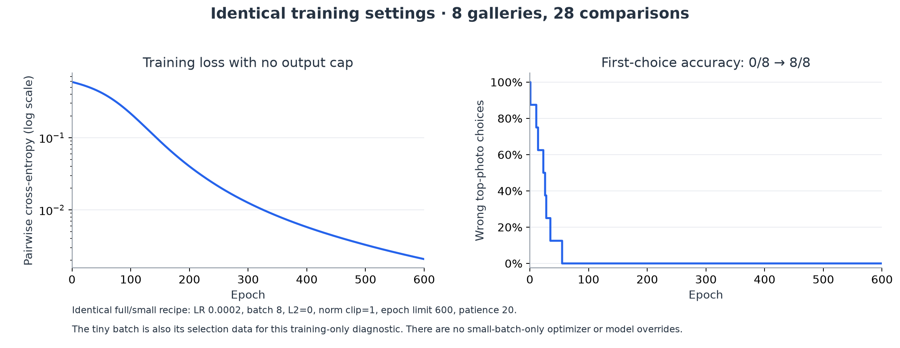
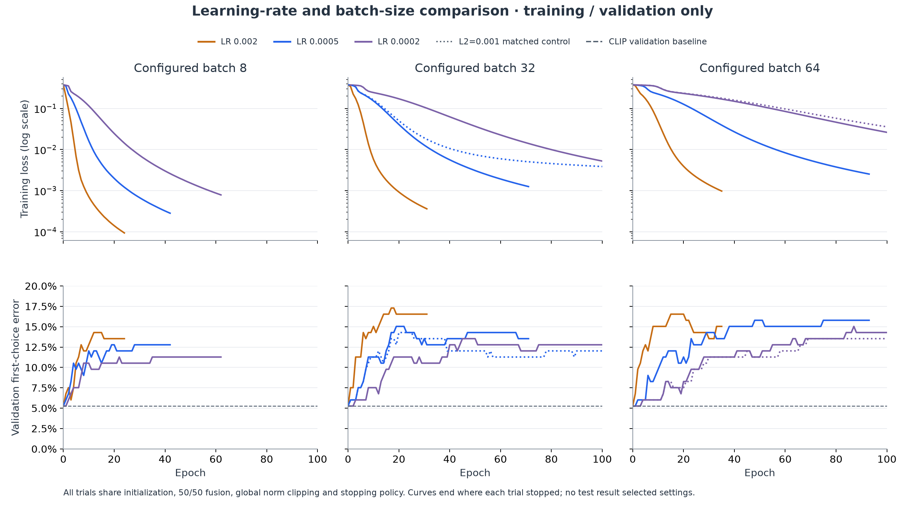
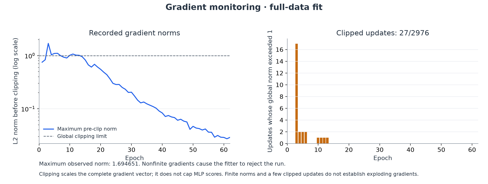
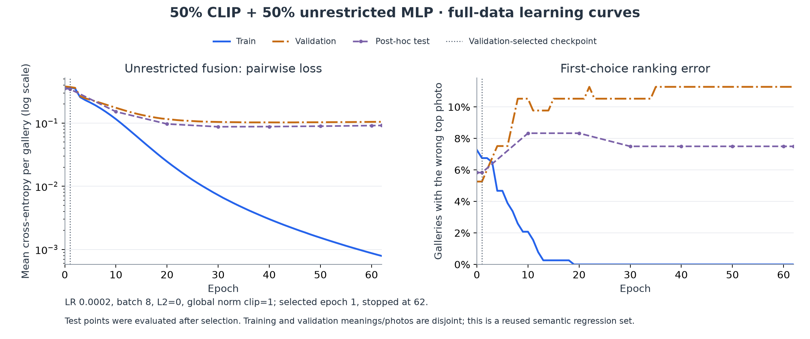
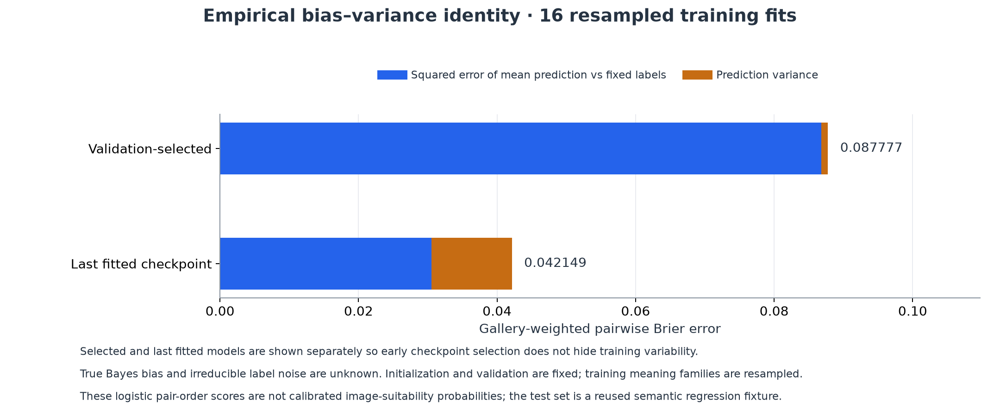

# Unrestricted CLIP–MLP fusion and training diagnostics — 1.12.6

The MLP can now fit the entire training set: **385/385 correct first choices**,
with fused pairwise loss **0.000787689** and MLP-only loss **0.000004115**. The
previous ±0.08 output restriction has been removed for current models.

Generalization remains the limiting result. CLIP matches **113/120** reviewed
test choices; the validation-selected fusion also matches **113/120**, while
the final fitted checkpoint matches **111/120**. The generic candidate is saved
for inspection but is not activated or used to initialize personal learning.

This is public-photo **meaning-correctness pretraining**, not an evaluation of
an individual's taste. The current FP16-text/FP32-vision features are reused
unchanged from the verified 1.12.5 pixel run. There are 2,390 comparisons in 638
galleries, 237 meanings and 1,736 source photographs. Training has 1,459 pairs /
385 galleries; validation 475 / 133; test 456 / 120. Meanings, meaning families,
photo IDs, canonical URLs and hashes remain disjoint across partitions. The
agent-reviewed dataset has already been inspected; it is not a fresh blind test.

## What changed

Current scoring is **`0.5 × CLIP score + 0.5 × MLP score`**. The MLP has a linear,
unrestricted output: no tanh residual cap, no ±0.04 personal cap and no
competing-sense positive-output clamp. Its 1,539→32→16→1 architecture still has
49,825 parameters. All are trainable in the shared default recipe.

Five trainable signed scalar routes initialize the MLP to reproduce CLIP's
selected-scene, competing-meaning and unwanted-content signals. Remaining
nonlinear units retain deterministic random initialization. This starts the
two branches in agreement and at comparable score scale; it does not freeze
the routes or limit later scores. Equal coefficients do not force equal output
variance. An unrestricted learned branch can dominate a ranking as it trains.
Tests explicitly verify it can overturn a CLIP gap greater than the retired cap.

The scoring version is `meaning-mlp-32-16-fusion-v2`. Old bounded heads remain
readable for archived offline results, but production cannot load or continue
training them as current heads. Existing feedback/features remain saved and
reusable when their encoder matches. The older ±0.08/±0.04 code paths serve only
archived V1 models; current V2 inference returns through unrestricted fusion.

## Identical small-batch and full-data training

The tiny and full runs call the **same runner and numerical fitter**, with the
same recipe JSON and hash. There is no small-batch-only change in learning
rate, regularization, loss, clipping, architecture, initialization or stopping.

| Setting | Both final runs |
| --- | --- |
| Encoder | Frozen pinned MobileCLIP-S0; text FP16, vision FP32 |
| Input | 512 image values + 512 meaning values + 512 elementwise products + 3 CLIP signals |
| MLP | 1,539 → 32 ReLU → 16 ReLU → 1 linear; Float32 weights/activations |
| Fusion | CLIP 0.5, MLP 0.5; unrestricted learned output |
| Objective | Mean gallery-weighted pairwise logistic cross-entropy; `sigmoid(8 × score difference)` |
| Optimizer | Adam, learning rate **0.0002**, β₁ 0.9, β₂ 0.999, ε 10⁻⁸ |
| Batch | **8 galleries**; each gallery's pairs have total weight one |
| Regularization | **0**, in both runs |
| Gradient clipping | **Global L2 norm 1**, before Adam; no output-score clipping |
| Epoch limit | **600** in both runs |
| Stopping | Selection-data loss, patience **20**, minimum improvement **0.00001** |
| Checkpoint selection | Highest selection-data first-choice count, then lowest pairwise loss; includes initialization |
| Safety budget | 1,800,000 ms for both offline runs; neither hit it |
| Initialization/order | Seed 78123; identical trainable CLIP-matching routes; cyclic one-gallery rotation each epoch |
| Other layers | No dropout or batch normalization; encoder not fine-tuned |

The tiny run supplies its own eight training galleries as selection data solely
to test memorization. The full run supplies the separate validation partition.
This data difference is explicit; the tiny run is not held-out evaluation.

Tiny: eight initially misranked galleries from distinct training meaning
families, with **28 comparisons**. Correct first choices improve **0/8 → 8/8**,
and all 28 pair orders become correct. Loss falls from about **0.592550 to
0.002083** over 600 epochs. It continues decreasing without an artificial floor.

The full run stops after 62 epochs. Validation selects epoch **1**, before
further memorization harms first-choice accuracy. The tiny run performs 600
updates; the larger dataset performs **2,976** updates across its 62 epochs.
Identical hyperparameters do not imply an identical number of minibatches when
dataset sizes differ.

The current production training entry point reproduces **both** recorded
offline checkpoints bit-for-bit. Production loads the shared optimizer/model
recipe from `js/ml/imageTrainingRecipe.js`. The app separately retains a
**20-second worker scheduling budget**; the offline experiment has the longer
budget above. Numerical scoring/fitting is identical, and training stays off
the interface thread. Production minimum-data and held-out acceptance guards
are not bypassed by the tiny-batch diagnostic.

## Hyperparameter comparison and instability

Nine unregularized pilot configurations test learning rates **0.002, 0.0005 and
0.0002**, crossed with batches **8, 32 and 64**. Two matched controls use L2=0.001:
LR 0.0005/batch 32 and LR 0.0002/batch 64. Every trial uses the same seed, score
architecture, global norm clip, stopping policy and a 100-epoch pilot limit.
Final runs share the 600-epoch recipe above. Test results do not select settings.

| Learning rate | Batch | L2 | Best validation correct | Selected epoch | Actual pilot epochs |
| ---: | ---: | ---: | ---: | ---: | ---: |
| 0.002 | 8 | 0 | 126/133 | 0 | 24 |
| 0.002 | 32 | 0 | 126/133 | 0 | 31 |
| 0.002 | 64 | 0 | 126/133 | 0 | 35 |
| 0.0005 | 8 | 0 | 126/133 | 0 | 42 |
| 0.0005 | 32 | 0 | 126/133 | 0 | 71 |
| 0.0005 | 64 | 0 | 126/133 | 1 | 93 |
| **0.0002** | **8** | **0** | **126/133** | **1** | **62** |
| 0.0002 | 32 | 0 | 126/133 | 2 | 100 |
| 0.0002 | 64 | 0 | 126/133 | 3 | 100 |
| 0.0005 | 32 | 0.001 | 126/133 | 0 | 100 |
| 0.0002 | 64 | 0.001 | 126/133 | 3 | 100 |

Epoch zero is the CLIP-matching initialization. Every configuration ties CLIP's
best validation first-choice count. Among the unregularized ties, LR 0.0002 /
batch 8 has the lowest validation pairwise loss (0.372336), so it is selected by
the predefined rule. Larger batches were tested; they did not improve that
validation count in this grid. These results do not establish a globally optimal
learning rate or batch size. Different batch sizes also make different numbers
of optimizer updates per epoch.

Repeated passes over the same data do not guarantee monotonically decreasing
loss. Each minibatch supplies a different gradient; Adam changes momentum and
per-coordinate update scales. A large learning rate can produce oscillation.
The current batch rule also folds a final remainder smaller than half a batch
into the preceding batch, instead of giving a one-gallery tail a full update.
No observation is dropped or duplicated.

The selected fit records maximum pre-clip gradient norm **1.694651**. **27 of
2,976 updates** are clipped; logged norms remain finite and shrink as fitting
progresses. This is evidence that norm clipping is applied, not evidence that
the earlier bounded model suffered exploding gradients. Gradient clipping
rescales gradients; it does not cap the learned score. CLIP embedding L2
normalization is a separate existing operation and remains unchanged.

## Selected checkpoint versus the final fitted checkpoint

| Partition | CLIP correct | Selected fusion, epoch 1 | Last fusion, epoch 62 |
| --- | ---: | ---: | ---: |
| Training | 357/385 (92.73%) | 359/385 (93.25%) | **385/385 (100%)** |
| Validation | 126/133 (94.74%) | 126/133 (94.74%) | 118/133 (88.72%) |
| Test | **113/120 (94.17%)** | **113/120 (94.17%)** | 111/120 (92.50%) |

| Partition | Selected fused loss | Last fused loss | Last MLP-only loss |
| --- | ---: | ---: | ---: |
| Training | 0.365841 | **0.000788** | **0.000004** |
| Validation | 0.372336 | 0.104788 | 0.145346 |
| Test | 0.345200 | 0.091668 | 0.134771 |

MLP-only first choices at the selected checkpoint are 360/385 training,
125/133 validation and 113/120 test. At the last checkpoint they are 385/385,
118/133 and 111/120. The unrestricted head substantially changes rankings as it
trains; the later fit is not constrained to a small CLIP correction.

This network demonstrably memorizes the training set. Lower pairwise loss on
held-out examples still does not ensure a better top candidate: most pair
comparisons are easy, and stronger separation there can outweigh a few incorrect
top choices in the average loss. Checkpoint selection now prioritizes validation
ranking before using loss as a tie-breaker. Before promoting personal weights,
the app also requires complete held-out choice accuracy not to regress against
the current model, CLIP and any validated semantic baseline; improved average
pairwise accuracy alone is insufficient. Test points are computed afterward,
every tenth epoch plus the selected and final checkpoints. The test set has
already been inspected; these are regression observations, not a new blind
estimate of generalization or personalized taste.

The split also changes the target meanings: 141 training meanings, 49 different
validation meanings and 47 different test meanings. It measures unseen-meaning
transfer. Personalization for an already observed meaning needs a separate
known-meaning/new-photo evaluation, with source photos kept disjoint. A further
possible COCO-to-app-search photo-domain mismatch has not been measured. The
observed gap does not isolate domain shift from overfitting or loss/metric
misalignment; no known-meaning personalization result is claimed here.

The original tiny-batch floor near 0.206 came from bounded score margins. For
equal CLIP scores, opposite ±0.08 corrections could add only 0.16 to a pair's
margin: `sigmoid(8 × 0.16) ≈ 0.7824`, leaving loss around 0.245. Baseline margins
made the original batch's average lower bound 0.205955. Current linear output
removes that artificial floor. Logistic loss can approach zero as margins grow;
finite training need not produce an exactly zero floating-point loss.

## Bias–variance evidence

Sixteen fits resample the 131 training meaning families. Each uses the same
selected recipe, fixed seed, original validation data and checkpoint rule;
test data is evaluated afterward. Selection and raw final fitting are reported
separately so conservative checkpoint selection does not conceal variability.

| Prediction rule | Squared error of average prediction vs fixed labels | Prediction variance | Average total Brier error |
| --- | ---: | ---: | ---: |
| Validation-selected checkpoint | 0.086837 | 0.000940 | 0.087777 |
| Last fitted checkpoint | 0.030516 | 0.011634 | 0.042149 |

For each fixed reviewed pair label, the finite identity is
`mean[(p − y)²] = (mean[p] − y)² + mean[(p − mean[p])²]`, then gallery-weighted.
The identity residual is below 2×10⁻¹⁶; the table is rounded. Variance uses
denominator 16. It is conditional on the chosen hyperparameters, initialization,
validation set and family resampling scheme. Shared training photographs can
create dependencies beyond those families.

This is an empirical fixed-label decomposition, not an identified population
Bayes bias/noise decomposition. True conditional probabilities and irreducible
annotation noise are unknown. The logistic values describe pair ordering and
are not calibrated per-image suitability probabilities. The smaller Brier error
of the later fits does not overturn their poorer first-choice ranking result.

## Verification and reproduction

- [Protocol fixed before fitting](image-fusion-v2-protocol.json)
- [Complete pilot curves](image-fusion-v2/pilot-report.json)
- [Full training, ablations and epoch curves](image-fusion-v2/training-report.json)
- [Tiny-batch record and identical recipe hash](image-fusion-v2/small-batch.json)
- [Production entry-point replay and matching weight hashes](image-fusion-v2/production-replay.json)
- [Numerical-core/source verification](image-fusion-v2/source-verification.json)
- [Sampled finite-difference gradient check](image-fusion-v2/gradient-check.json)
- [Perturbation-size study](image-fusion-v2/gradient-step-study.json)
- [Independent NumPy verification, selected](image-fusion-v2/independent-verification.json)
- [Independent NumPy verification, last](image-fusion-v2/last-independent-verification.json)
- [Saved models and commands](../tests/fixtures/image-fusion-v2/README.md)

The gradient check covers 18 smooth coordinates across all three layers, using
perturbation 0.001 and absolute tolerance 0.00002. Maximum absolute error is
0.000006264. A 0.0001 perturbation was too small for this Float32 output scale;
0.0003, 0.001 and 0.003 all pass the unchanged tolerance. That diagnostic change
does not change training hyperparameters or weights. Independent NumPy forward
passes reproduce both checkpoints' ranking metrics and both decompositions.

The published numerical core is unchanged from the actual experiment; the
production wrapper now loads the shared recipe. Exact replay verifies both
weight hashes. Archived V1 weights cannot silently become V2 weights. No new
technical picker UI or user labeling tasks were added. This desktop experiment
does not establish physical-phone performance, all-wrong rejection calibration,
or quality outside the fixed reviewed galleries.
