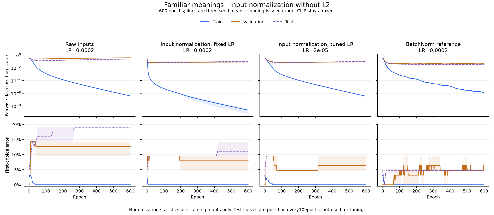
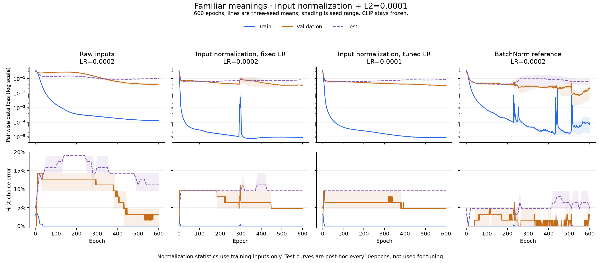
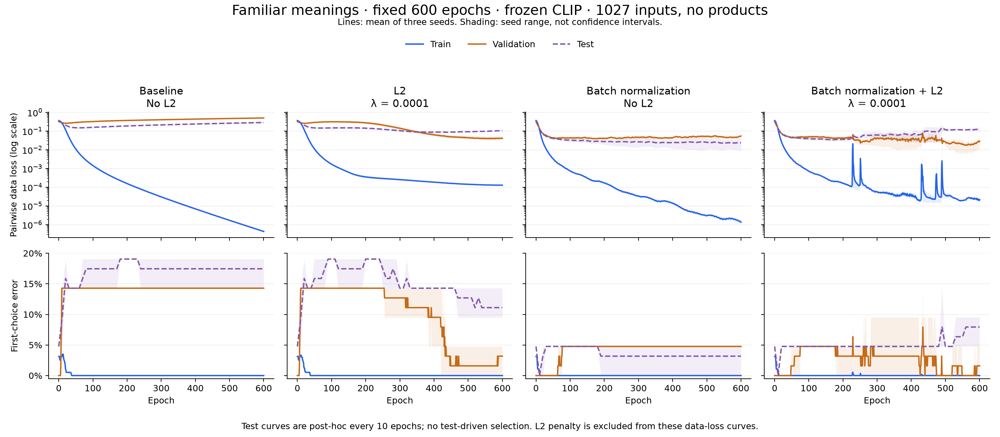
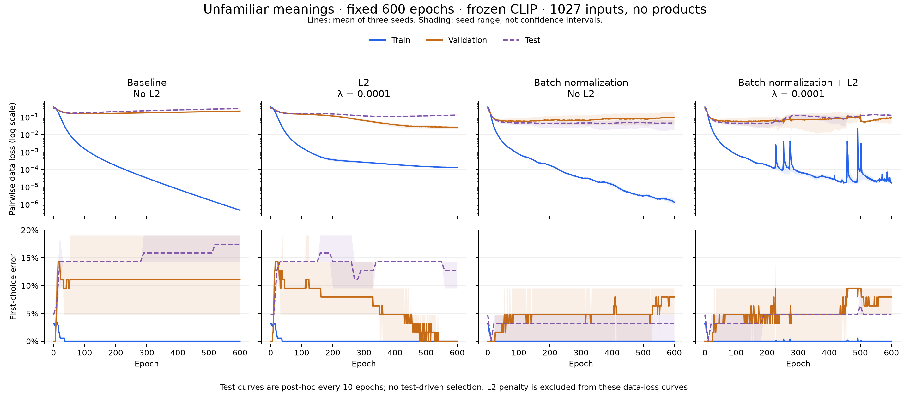
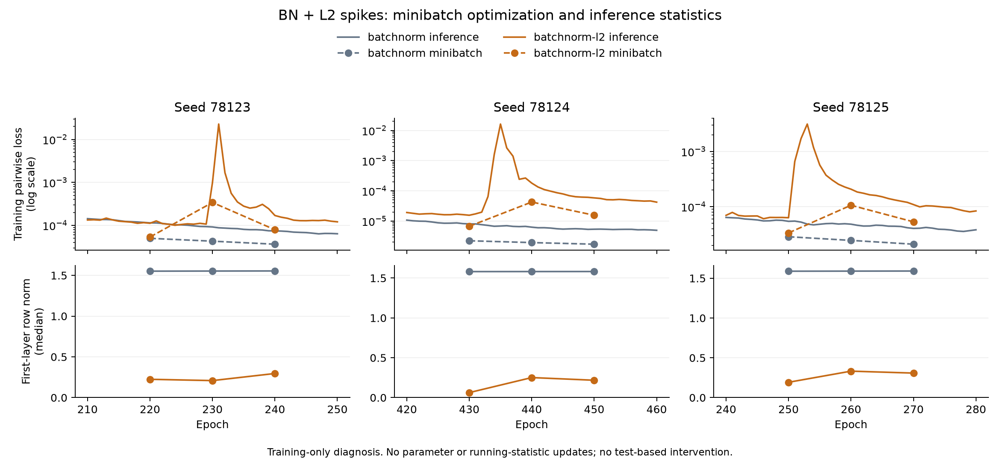

# Input normalization and interaction-feature ablation — 1.12.8

**Batch normalization alone remains the strongest observed ranking candidate.**
Input standardization did not beat the selected baseline/BatchNorm first-choice
results. It did help the familiar-meaning L2 variant recover a 20/21 selected
result after learning-rate tuning, but those checkpoints are very early and
still only tie CLIP. Removing explicit image×meaning products made the trained
head smaller without a consistent accuracy improvement or loss in the
BatchNorm-only comparison.

These are separate user-requested follow-ups to the
[four-way L2/BatchNorm study](image-regularization.md), requested after its test
results were inspected. They are exploratory retrospective comparisons, not
fresh blind tests. Every new setting/checkpoint is chosen using training and
validation data before that follow-up's test scoring. No test-driven retuning
is performed. Original data, models and the parent study are preserved.

## Input normalization without BatchNorm

The image/text embeddings already have unit length. This experiment additionally
centers/scales **each of the 1,539 MLP coordinates** using mean and standard
deviation fitted on unique training photo/meaning rows. Standard deviation is
floored at **0.001**. The identical frozen transform is used for validation/test;
their values never fit or update it. This is a fixed affine input transform,
so it retains input information rather than discarding per-image magnitude as
an example-wise normalization can. The original CLIP score branch is untouched.

The first dense weights/biases are reparameterized to preserve the initial
inference function. Both normalized families retain the 512 product features.
No BatchNorm is mixed into these models. With L2, the penalty applies to the
transformed dense kernels, so scaling changes the regularization prior as well
as optimization conditioning; this interaction should not be ignored.

Fixed settings use **LR=0.0002**, batch **8**, global gradient norm clip **1**,
600 epochs without patience stopping. The L2 coefficient stays **0.0001**.
A separate validation-only pilot compares learning rates
**0.00002, 0.0001, 0.0002**, using seed 78123 across both exposure arms. It
maximizes selected first-choice count, then minimizes pairwise data loss.
Validation chooses **0.00002 without L2**, **0.0001 with L2**. Those settings
then run across all three seeds. There are 28 distinct fits: 12 pilots plus
16 additional fits, yielding 24 fixed/tuned final comparisons.

Each number below is correct choices **out of 21**, in seed order 78123/24/25.

| Input-normalized model | LR | Familiar: selected | Familiar: epoch 600 | Unfamiliar: selected | Unfamiliar: epoch 600 |
| --- | ---: | --- | --- | --- | --- |
| No L2, fixed | 0.0002 | 20,20,20 | 18,19,19 | 20,20,20 | 18,18,19 |
| No L2, tuned | 0.00002 | 20,20,19 | 19,19,19 | 19,19,19 | 18,18,19 |
| L2, fixed | 0.0002 | 20,19,20 | 19,19,19 | 19,19,19 | 19,19,19 |
| L2, tuned | 0.0001 | 20,20,20 | 19,19,19 | 19,19,19 | 19,19,19 |

The fixed, unregularized familiar models select **epoch 0** in all three seeds:
their 20/21 accuracy retains the initial CLIP-matching function. The tuned
L2 familiar models select **epoch 1**. These ties therefore do not demonstrate
a learned image-picking improvement. Tuning validation did not translate to a
consistent test advantage. A broader joint search over normalization methods,
learning rates and regularization strengths was not performed; the L2
coefficient was held fixed in this follow-up.

The raw-input references retain the original architecture and settings. In the
fixed-normalization panels only preprocessing/its equivalent initialization
change; the tuned panels also change learning rate. Test curves are post-hoc
every ten epochs. Lines are three-seed means and shading is seed range, not
confidence intervals. Curves show pairwise **data** loss, excluding L2 penalty.

## Removing the 512 explicit product features

The compact model receives **1,027 coordinates**:

- 512 image-embedding coordinates.
- 512 target-meaning embedding coordinates, from word, part of speech and definition.
- Three CLIP target-match/competing-meaning/unwanted-content signals.

The 512 elementwise image×meaning products are physically removed from the
first dense matrix. Hidden layers remain **32 → 16**. Dense parameters decrease
**49,825 → 33,441** (16,384 fewer, about 32.9%). BatchNorm adds 96 gain/shift
parameters to either architecture. Meaning information remains supplied, and
the hidden nonlinearities can still learn interactions. The three CLIP
signals also already relate the image to the target text.

Retained initial weights are copied from the parent seeds, rather than
re-randomized. The initial CLIP-matching scores are preserved. The ablation uses
raw inputs with no new standardization. All four parent families are rerun:
baseline, L2, BatchNorm, and both; **LR=0.0002**, L2 **0.0001** where applicable,
batch **8**, gradient clip **1**, fixed **600 epochs**, three seeds and both
exposure arms. No new hyperparameter selection is performed for this ablation.

| Compact model | Familiar: selected | Familiar: epoch 600 | Unfamiliar: selected | Unfamiliar: epoch 600 |
| --- | --- | --- | --- | --- |
| Baseline | 20,20,20 | 18,17,17 | 20,20,20 | 18,17,17 |
| L2 | 19,18,20 | 19,18,19 | 19,18,18 | 19,18,18 |
| BatchNorm | **20,20,20** | **21,20,20** | **20,20,21** | **20,20,21** |
| BatchNorm + L2 | 20,19,19 | 20,19,19 | 20,20,21 | 20,20,20 |

The full-input BatchNorm model scores 20,20,20 on familiar test choices at both
selected and final checkpoints. Removing products leaves selected counts
unchanged, with one final seed improving by one choice. Unfamiliar BatchNorm
counts are unchanged. Combined BatchNorm+L2 familiar counts get slightly worse
with deletion. These results do not justify a broad claim that the products
are harmful or necessary.

Deleting inputs also removes parameters, and reduces the number of terms in
the L2 penalty. This is a feature/capacity ablation, not a fixed-parameter
comparison. Only the one previously selected L2 coefficient is evaluated.

For compatibility checks, compact models can be expanded to ordinary runtime
weights with exactly zero columns for the deleted products. Native training
really uses 1,027 inputs; expansion is only an inference verification format.

## Why the BatchNorm + L2 curve has spikes

L2 shrinks kernels before BatchNorm. Normalization can compensate for that
scale change, so the same nominal optimizer setting can produce larger
effective changes relative to the smaller weights. The parent study observes
much smaller kernel norms and larger effective BN gains in the combined model,
consistent with the known [L2/normalization interaction](https://arxiv.org/abs/1706.05350).

The plotted training loss uses inference-mode running statistics. A
training-only check of seed 78123 gives:

| Training-set calculation | Epoch 220 | Epoch 230 |
| --- | ---: | ---: |
| Current eight-gallery minibatch statistics | 0.0000534 | 0.0003404 |
| Frozen running statistics, as plotted | 0.0001119 | 0.0009816 |

Both optimization instability and the normalization-statistic mismatch
contribute. Clipping bounds the gradient norm but does not guarantee smooth
loss curves or bound Adam steps relative to each weight's size. This is not
solely overfitting or a plotting artifact. The diagnosis does not uniquely
prove the cause of every spike, and no test-based intervention follows it.

## Checks, interpretation and artifacts

All full models train 600 epochs; checkpoint selection is separate. Every
tiny-fit cohort uses the same fitting kernel/settings as its full counterpart,
with its own training-only normalization/calibration statistics. All eight
follow-up tiny cohorts reach **8/8 choices and every pair correct**. Sampled
finite differences pass for normalized and compact models, with/without L2
and BatchNorm where relevant.

Independent JavaScript native inference and ordinary folded runtime weights
verify **144 split/checkpoint evaluations per follow-up**. All rankings agree.
Maximum native metric differences from NumPy are below **10⁻¹⁵**; maximum
folded fused-score differences are **2.38×10⁻⁷** for input normalization and
**4.77×10⁻⁷** for feature deletion. The original source data/labels/embeddings
remain byte-for-byte unchanged. All 28 normalization and 24 ablation fits are
archived alongside the 32 parent fits.

These experiments still use the same 21 reviewed test meanings, largely easy
distractors, one training exposure per target meaning, and retrospectively
studied photos. Repeated seeds/configurations are not independent test samples.
Paired meaning-bootstrap comparisons are conditional exploratory summaries,
not evidence of a statistically established population improvement. A lower
average loss is not sufficient to claim better first-choice image picking.

The practical candidate remains **BatchNorm alone** for further fresh-photo
verification. Product deletion is a plausible parameter-saving option under
this small benchmark; input normalization did not establish a better ranking
option. The production personal learner and active generic head are not
switched to these experimental models by this release.

- [Parent experiment and complete hyperparameters](image-regularization.md)
- [Paired follow-up summaries](image-regularization/followup-summary.json)
- [Input-normalization protocol](image-input-scaling-protocol.json)
- [Feature-ablation protocol](image-interaction-ablation-protocol.json)
- [Input-normalization data/commands](../tests/fixtures/image-input-scaling/README.md)
- [Feature-ablation data/commands](../tests/fixtures/image-interaction-ablation/README.md)
- [Normalized native/folded verification](image-input-scaling/independent-inference.json)
- [Compact native/folded verification](image-interaction-ablation/independent-inference.json)
