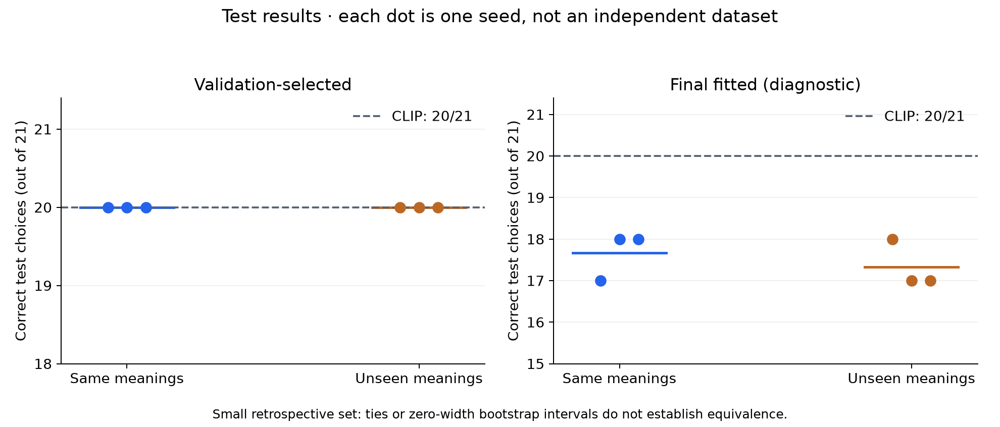
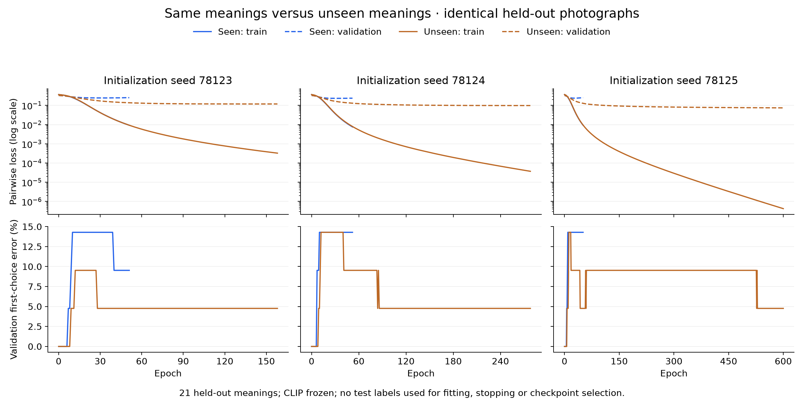

# Does seeing the same meanings improve the MLP? — 1.12.7

**This controlled check did not demonstrate a first-choice benefit.** CLIP and
both validation-selected MLP arms achieve **20/21** correct test choices, for
all three initialization seeds. Merely overlapping target meanings did not
repair ranking in this experiment. The small, mostly easy, retrospectively
curated sample cannot establish whether meaning shift is the main cause of
real-app failures, or rule out a benefit with more examples per meaning.

CLIP was **not retrained**. Its pinned FP16 text / FP32 vision MobileCLIP-S0
features stay frozen. Only the MLP is fitted, from scratch, in each arm.
Neither experimental head is activated in the application.

## The comparison

Both arms have **191 training galleries / 97 meanings / 95 meaning families**.
They share the identical 170-gallery background:

- **Seen:** add one training gallery for each of 21 target meanings.
- **Unseen control:** instead add one gallery from each of 21 other families,
  absent from the common background. No validation/test target family enters
  this arm's training data.

Validation contains 21 galleries, one per target meaning. Test contains another
21 galleries for those same meanings. Every validation/test meaning therefore
occurs in seen-arm training. Both models are evaluated on the **identical**
held-out galleries, so different test difficulty cannot explain an arm difference.

Every candidate photo, including distractors, is disjoint across training,
validation and test. Checks cover photo ID, byte hash, canonical URL, source URL
and declared duplicate group. All 1,736 source files were hash-verified; a
128-bit difference-hash/aspect-ratio screen found no near-duplicate pairs at its
stated threshold. This is a screen, not a guarantee of perceptual independence.

| Partition | Seen arm | Unseen arm |
| --- | ---: | ---: |
| Training galleries | 191 | 191 |
| Training comparisons | 697 | 698 |
| Training meanings | 97 | 97 |
| Training distinct photos | 678 | 645 |
| Validation galleries / meanings / comparisons | 21 / 21 / 81 | Identical |
| Test galleries / meanings / comparisons | 21 / 21 / 81 | Identical |

Exposure matching uses metadata only: 20/21 pairs match domain, and 20/21 match
candidate count. Dessert versus bag is the domain exception; snow has four
candidates versus rain's five. Photo diversity and semantic composition are
not perfectly matched, so this is a conditional exploratory comparison rather
than a clean causal identification of meaning exposure.

## Review and preservation

Luna and Terra made **807 candidate judgments across 168 galleries**, without
the proposed reference or model scores: 102 proposed held-out galleries, 37
surviving target-exposure galleries and 29 surviving control galleries. An
18-gallery root spotcheck is recorded separately. Review follows the fixed
definition and visible object/action/relation, rather than aesthetics or captions.

The metadata allocation proposed 51 target groups. A group is retained only if
its target training/validation/test galleries and matched control all confirm
exactly the original single valid reference, every alternative is wrong, and
no candidate is uncertain. **21 groups survive; 30 fail strict confirmation.**
This counts groups, not 30 proven label errors. Some cases have ambiguous
actions, multiple valid photos, or strict disagreements with historical review.
Those records need adjudication before future use as ground truth. The common
background retains historical labels and was not re-reviewed in this experiment.

A metadata-only exploration across all original splits yielded 78 candidate
targets, but left only one common background gallery and 17 domain mismatches.
It was rejected before fitting. No model scores selected the retained meanings,
matching, review exclusions or hyperparameters.

The original **638 galleries / 2,390 comparisons / 237 meanings** remain
byte-for-byte unchanged, including old split assignments and both archived
encoder datasets. The new fixture references source IDs instead of replacing
the original data. Every source gallery is accounted for in the new experiment
or its preserved-outside-experiment list (384 galleries).

All new validation/test galleries originated in the old training partition.
Consequently, the old fitted MLP cannot be used here: each new model starts
from scratch and excludes every held-out photo. Some old validation/test
galleries now supply experiment training, so these models must not be scored
against the old split as an independent benchmark. Historical artifacts remain
available for reproduction and future training.

## Fixed training and results

The architecture and recipe are unchanged from 1.12.6:
**1,539 → 32 ReLU → 16 ReLU → 1 linear**, 49,825 trainable parameters;
unrestricted **0.5 CLIP + 0.5 MLP** fusion; gallery-weighted pairwise logistic
loss; Adam LR **0.0002**, batch **8**, regularization **0**, global gradient norm
clip **1**, maximum **600 epochs**, validation-loss patience **20**, minimum
improvement **0.00001**. All layers train. The offline safety budget is 30 minutes;
no run hits it. The app's separate 20-second worker budget is unchanged.

Seeds are 78123, 78124 and 78125. Checkpoints maximize validation first-choice
count, then minimize validation pairwise loss, including initialization. All
six fits/checkpoints and weight hashes are frozen **before** aggregate test
scoring. No test-dependent retuning occurs.

| Seed | Arm | Selected epoch | Actual epochs | Selected train correct /191 | Selected validation /21 | Selected test /21 | Final test /21 |
| ---: | --- | ---: | ---: | ---: | ---: | ---: | ---: |
| 78123 | Seen | 6 | 51 | 187 | 21 | 20 | 17 |
| 78123 | Unseen | 8 | 158 | 186 | 21 | 20 | 18 |
| 78124 | Seen | 6 | 52 | 185 | 21 | 20 | 18 |
| 78124 | Unseen | 8 | 278 | 185 | 21 | 20 | 17 |
| 78125 | Seen | 5 | 51 | 186 | 21 | 20 | 18 |
| 78125 | Unseen | 6 | 600 | 186 | 21 | 20 | 17 |

CLIP alone gets 21/21 validation and 20/21 test. The selected MLPs retain the
same success/failure pattern. The remaining baseline miss is the held-out
**uniform** gallery. Every final fitted model memorizes all **191/191** training
galleries; both arms lose test accuracy with prolonged fitting.

Mean selected test pairwise loss is **0.299204 seen** versus **0.292296 unseen**.
The seen arm's loss is slightly worse: mean paired improvement (unseen minus
seen) **−0.006908**, whole-meaning bootstrap interval **[−0.011918, −0.001978]**.
This secondary loss observation does not change the primary first-choice tie.
Final fitted test losses average 0.130435 and 0.199023 respectively, despite
their poorer first-choice counts. Lower average pairwise loss still need not
produce a better top candidate.

## Uncertainty and interpretation

The primary seen-minus-unseen accuracy difference is **0 percentage points**.
There are no discordant selected correctness outcomes. Resampling those same
21 observed meanings produces a degenerate **[0, 0]** bootstrap interval; that
does **not** establish population equivalence. The exact per-seed discordance
test has p=1 because there are no discordant cases, not because it proves equal
quality. With zero observed discordance among 21 hypothetical independent
sampled meanings, a one-sided 95% upper bound on an unseen discordance rate is
still about **13.3%** (the per-seed binary fields in the JSON). Seed-averaged
binary-test fields are intentionally null because those outcomes can be
fractional. This curated dataset does not guarantee that sampling model.

The final fitted checkpoints average 17.667/21 seen versus 17.333/21 unseen:
only **+1.59 percentage points**, with paired meaning-bootstrap interval
**[0, +4.76]**. It is a diagnostic across different validation-stopping epochs,
not a second acceptance result or evidence that the overfit head should ship.

The three seeds reuse the same 21 test meanings; they are not 63 independent
test cases. The sample is small, review-agreement-selected, largely composed
of easy unrelated distractors, and drawn from one photo source. It gives only
one training example per target meaning. The photos/labels were studied in
historical experiments; this is retrospective held-out regression, not a fresh
blind test. It measures semantic correctness, not personal taste.

**Supported conclusion:** same-meaning overlap alone did not improve selected
first-choice performance here. The evidence does not identify meaning shift as
the main cause, nor rule it out under richer training or real search images.
The next stronger comparison needs several independent training photos per
meaning and more clearly verified, difficult action/relation alternatives from
the app's search source, while maintaining a fresh photo-disjoint test set.

## Artifacts and checks

- [Fixed protocol](image-meaning-shift-protocol.json)
- [Complete metrics, curves, paired results and weight hashes](image-meaning-shift/report.json)
- [Split, preserved-record list, review audit and reproduction commands](../tests/fixtures/image-meaning-shift/README.md)
- [Independent NumPy check: all 36 split/checkpoint evaluations](image-meaning-shift/independent-verification.json)

The original strict meaning-disjoint validator is unchanged. A separate offline
validator enforces the new experiment's overlap policy and photo isolation.
Numerical training/scoring source, shared recipe and CLIP files are unchanged.
No experimental model, extra labeling task or technical UI is added to the app.
