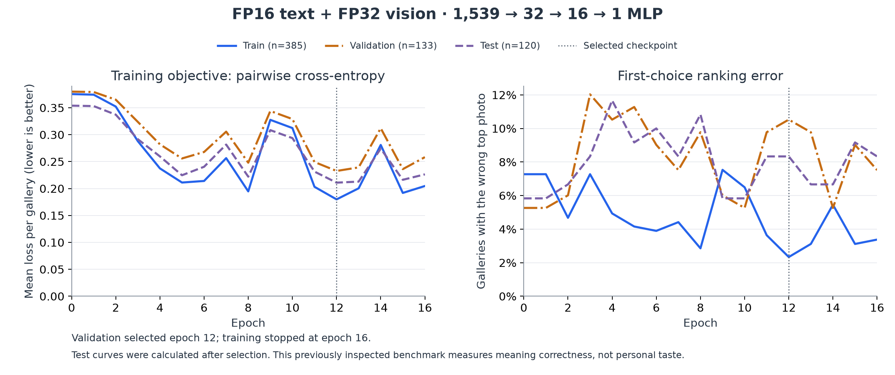
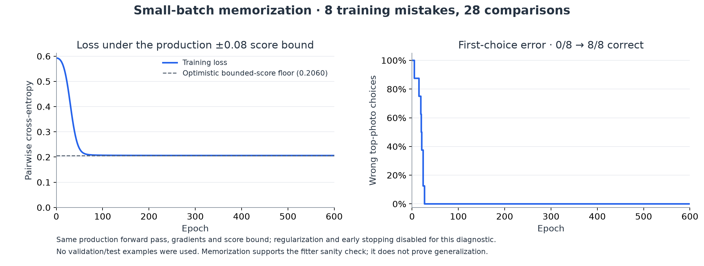
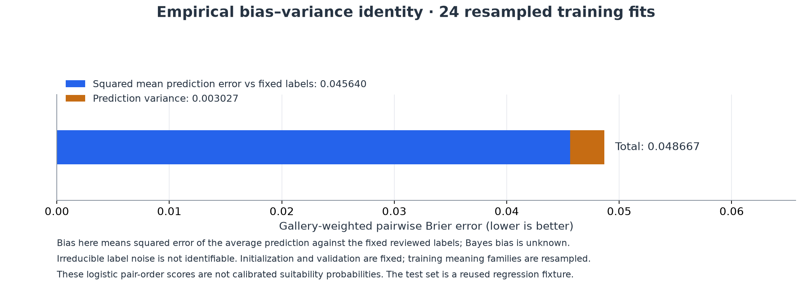

# Current-CLIP MLP retraining — 29 October 2026

This is the frozen **v1.12.5 bounded-head experiment**. Subsequent unrestricted
fusion uses a new scoring version; reproduce this experiment from tag v1.12.5.

The retrained MLP **does not improve first-choice image selection**. The current
app CLIP ranker matches 113/120 reviewed test galleries (94.17%); adding the MLP
matches 110/120 (91.67%). Its weights are saved for inspection and remain disabled.
It introduces three errors and fixes none of the baseline's seven test errors.

This experiment measures public-photo **meaning correctness**, not an individual
user's taste. The existing dataset and test set have already been inspected;
these are regression measurements, not fresh blind generalization estimates.

## Data and results

All 1,736 source photographs were downloaded and their original SHA-256 hashes
verified. The entire dataset was re-encoded with the pinned current encoder:
FP16 text and FP32 vision. No Q8 text vectors, historical trained layers or
model-generated replacement labels were reused. Definitions, scene prompts,
reviewed labels, exclusions and original partitions were preserved.

| Partition | Comparisons | Galleries | Meanings | Distinct photos | Raw cosine correct | App CLIP correct | CLIP + MLP correct |
| --- | ---: | ---: | ---: | ---: | ---: | ---: | ---: |
| Training | 1,459 | 385 | 141 | 1,036 | 352 | 357 (92.73%) | 376 (97.66%) |
| Validation | 475 | 133 | 49 | 355 | 126 | 126 (94.74%) | 119 (89.47%) |
| Test | 456 | 120 | 47 | 345 | 108 | 113 (94.17%) | 110 (91.67%) |

Whole meanings, declared meaning families, source photo IDs, canonical source
URLs and byte hashes stay in one partition. The original perceptual duplicate
screen is retained; neither byte hashes nor that screen prove universal visual
independence. Labels were independently agent-reviewed, with uncertainty and
other valid alternatives excluded. They are not professionally human-adjudicated
ground truth. Galleries contain 2–5 candidates, not an open-ended image search.

| Partition | CLIP pairwise loss | MLP pairwise loss | CLIP pairwise agreement | MLP pairwise agreement | MLP first-choice error |
| --- | ---: | ---: | ---: | ---: | ---: |
| Training | 0.375426 | 0.179883 | 97.49% | 99.20% | 2.34% |
| Validation | 0.379968 | 0.232661 | 98.25% | 96.74% | 10.53% |
| Test | 0.353914 | 0.210952 | 97.64% | 96.94% | 8.33% |

Loss and pairwise agreement average the comparisons within each gallery, then
average galleries. Each gallery gets one vote; four alternatives do not count
as four independent choices. First-choice error is 1 − correct-top-photo rate.
The plotted loss excludes the regularization penalty.

Validation loss selected epoch **12**. Training stopped after epoch **16**,
following four epochs without an improvement of at least 0.0001. Test curves
were calculated afterward, once optimization and checkpoint selection were
complete. They were not used to select an epoch or change the fixed recipe.

Lower average pairwise loss does not ensure a better top photo: the head can
increase margins against many easy alternatives while moving one competitor
above the correct reference. The training–validation first-choice gap is 8.19
percentage points; the training–test gap is 5.996 points. These gaps describe
generalization behavior; they are not numerical bias–variance decompositions.

The paired 95% family-bootstrap interval for the MLP's test first-choice change
is approximately **−8.70 to 0.00 percentage points**, averaging whole meaning
families. That family-weighted estimate differs from the gallery-weighted
−2.50-point change. There is no evidence of a reliable first-choice improvement.
Three regressions are `semantic-v2-flag-2`, `semantic-v2-plant-3`, and
`semantic-v2-green-1`. No test gallery is rescued.

## Exact training configuration

| Setting | Value |
| --- | --- |
| Encoder | `Xenova/mobileclip_s0`, revision `757d59c9c6870a76a4b0306f05f5061bca15c39f` |
| Precision | Text FP16; vision FP32; MLP weights/activations Float32 |
| Image preprocessing | Proportional full-frame resize, square letterbox, model normalization; no subject crop |
| Input | 512 image values + 512 target-meaning values + 512 elementwise interactions + 3 CLIP semantic signals |
| Architecture | 1,539 → 32 ReLU → 16 ReLU → 1 |
| Parameters | 49,825; both hidden layers and output trainable; encoder frozen |
| Output | App CLIP score plus `0.08 × tanh(head)` for semantic fitting |
| Competing-sense rule | Positive corrections are clamped to zero if the competing-meaning margin is negative |
| Objective | Gallery-weighted preferred-versus-wrong logistic cross-entropy, `sigmoid(8 × score difference)` |
| Optimizer | Adam; learning rate 0.002; β₁ 0.9; β₂ 0.999; ε 10⁻⁸ |
| Gradient clipping | Each component clipped to [−1, +1] after adding regularization |
| Regularization | Gradient `0.001 × (weights − initial weights)`; L2 anchor to initialization |
| Batch | 8 galleries, with each gallery's pair weights summing to one |
| Epoch limit | 30; 600,000 ms safety budget, which did not cause stopping |
| Early stopping | Validation pairwise loss; patience 4; minimum improvement 0.0001 |
| Initialization | Seed 78123; hidden uniform ±√(6/fan-in), hidden biases 0.01; output weights/bias initially zero |
| Order | Deterministic one-gallery cyclic rotation per epoch, as in the app trainer |
| Other layers | No dropout or batch normalization; no encoder fine-tuning |

The personal-preference residual limit remains ±0.04. This run trains the
separate semantic head, whose limit is ±0.08. Semantic examples are never
relabeled as observations of personal taste.

The protocol was written before this fit. Its complete machine-readable form is
[here](image-mlp-fp16-protocol.json); source, event, model-file and manifest
hashes are retained with the results.

## Pipeline checks

The diagnostics use the app's actual numerical fitter, not a separate PyTorch
implementation. Factoring out that fitter allowed direct small-batch checks
without weakening production minimum-data, split or acceptance guards.

- **Exact reproduction:** the diagnostic fitter reproduces every one of the
  unmodified v1.12.4 trainer's 49,825 final weights bit-for-bit on the fresh
  full dataset. A synthetic weight snapshot also guards the default recipe.
- **Finite differences:** 18 active coordinates across all three layers agree
  with analytical gradients. A perturbation crossing a ReLU boundary is logged
  and replaced by a smooth coordinate; the central derivative across that
  boundary is not an appropriate gradient check. Tolerances and all checked/
  skipped coordinates are saved, rather than silently discarding discrepancies.
- **Small-batch overfitting:** eight initially misranked training galleries from
  distinct meaning families, containing 28 comparisons, improve from 0/8 to
  8/8 correct first choices and 28/28 correct pair orders. No validation/test
  example enters this diagnostic.

The memorization run uses the same forward pass, gradients, optimizer, learning
rate, score bound and clamp. It sets regularization to zero, disables early
stopping and runs 600 epochs in a batch of eight. Loss falls from **0.592550 to
0.206003**, close to the optimistic bounded-score lower bound **0.205955**.

The loss cannot generally approach zero with this bounded residual: for equal
base scores, the largest additional pairwise margin is 0.16, producing
`sigmoid(8 × 0.16) ≈ 0.7824`, even under a perfect opposing correction.
Baseline margins alter the floor for each pair. This constraint explains the
nonzero memorization loss; it does not explain away the poorer test choices.
Every gallery in these partitions is theoretically correctable under the score
bound, although a shared neural network need not achieve every independent
per-photo bound simultaneously.

Memorization is useful evidence that optimization can learn. It does not prove
that labels, splits, preprocessing, activation decisions or generalization are
correct. Hash/split checks, numerical gradients and independent metric
recomputation address additional parts of that question.

## Bias–variance analysis

The saved [empirical decomposition](image-mlp-fp16/bias-variance.json) resamples
the 131 training meaning families 24 times, preserving all galleries belonging
to a sampled family. Each fit starts with seed 78123, uses the original fixed
validation partition for early stopping, and evaluates the original fixed test
partition afterward. No test example is used for fitting.

| Empirical component | Brier units |
| --- | ---: |
| Squared mean-prediction error against fixed labels | 0.04564048 |
| Prediction variance across 24 resampled fits | 0.00302694 |
| Average total squared prediction error | 0.04866742 |
| Irreducible noise / true Bayes bias | Not identifiable |

The metric is gallery-weighted pairwise Brier error. With `p̄` the average
prediction across resampled fits and fixed reviewed target `y`, the exact
empirical identity is:

`average[(p − y)²] = (p̄ − y)² + average[(p − p̄)²]`.

The first term is **squared mean-prediction error against these fixed labels**;
the second is **prediction variance across resampled training fits**. Opposite
pair orientations have complementary probabilities and the same Brier error.
The variance uses denominator 24, not an unbiased sample-variance correction,
so the finite empirical identity is exactly additive.

This is not an identifiable decomposition into population/Bayes bias, variance
and irreducible noise. There is only one retained label for each comparison;
noise and the true conditional suitability probability are unknown. The first
term includes score bounds and probability-calibration effects. Logistic pair
scores are not calibrated image-suitability probabilities. Fixed initialization
excludes initialization randomness; shared training photos can induce
dependencies not captured by family resampling. Twenty-four fits provide a
conditional diagnostic, not a precise population uncertainty estimate.

## Artifacts and reproduction

- [Complete metrics and epoch curves](image-mlp-fp16/training-report.json)
- [Small-batch record and full 600-epoch curve](image-mlp-fp16/small-batch-overfit.json)
- [Gradient coordinates, tolerances and boundary exclusions](image-mlp-fp16/gradient-check.json)
- [Exact old/new fitter comparison](image-mlp-fp16/fitter-parity.json)
- [Encoder/source-photo hash verification](image-mlp-fp16/encoder-provenance.json)
- [Independent NumPy metric verification](image-mlp-fp16/independent-verification.json)
- [Fresh features, candidate and reproduction commands](../tests/fixtures/image-pretraining-fp16/README.md)

The rejected head is not used to initialize personal learning. The regular
picker UI has no added technical counters, explanations or labeling work.
Pixel inference and fitting were run locally on desktop; they do not establish
physical-phone speed, memory, thermal behavior, retrieval quality outside these
fixed galleries or personalized preference quality.
