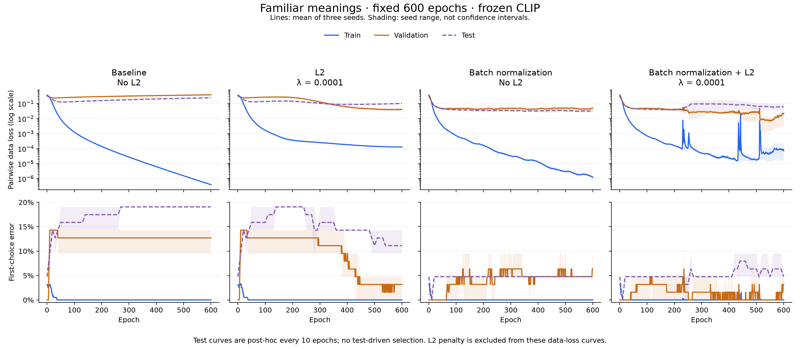
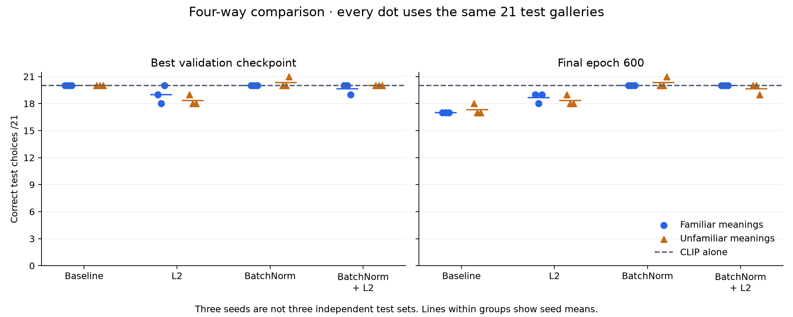
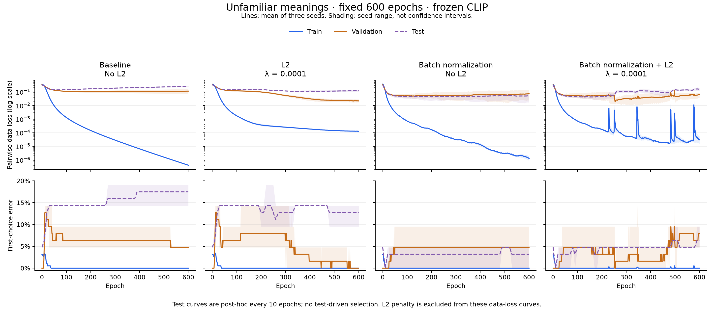
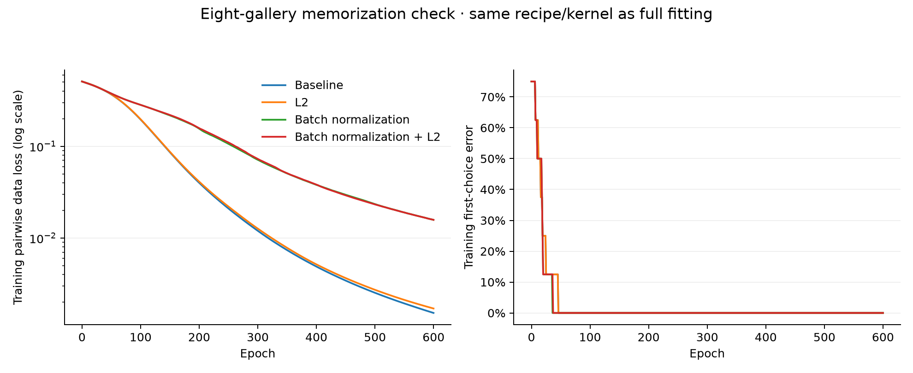

# Fixed-epoch L2 and batch-normalization experiment — 1.12.8

**Batch normalization alone is the most promising result in this comparison.**
For familiar meanings, all three final batch-normalized models get **20/21**
test choices correct, while all three unregularized models fall to **17/21**
after 600 epochs. However, the earlier validation-selected baseline also gets
20/21. This supports reduced deterioration during prolonged fitting, not an
established familiar-meaning first-choice improvement over the best baseline.

CLIP is frozen throughout. Only the MLP is trained. No new experimental head
is activated in the application, and the existing data/models are preserved.

Blue is training data loss, orange validation, purple post-hoc test. Top panels
use a logarithmic loss scale. Lines average three seeds; shading is their range,
not a confidence interval. The added L2 penalty is **excluded** from the plotted
data losses, so the curves compare the same objective across all variants.

## What was tested

The four families are baseline, ordinary L2, batch normalization, and batch
normalization plus L2. Each uses the same **1,539 → 32 → 16 → 1** hidden layout,
ReLU hidden activations, unrestricted linear output and 50/50 CLIP–MLP score
fusion. BatchNorm adds 96 trainable gain/shift parameters; dense-only models
have 49,825 parameters and BatchNorm models 49,921. No hidden layer was widened
or added. No LayerNorm, dropout or new input scaling is mixed into the study.

| Setting | All full fits and tiny checks |
| --- | --- |
| Frozen encoder | Pinned MobileCLIP-S0, FP16 text / FP32 vision |
| Epochs | **600**, with patience-based early stopping disabled |
| Optimizer | Adam LR **0.0002**, β₁=0.9, β₂=0.999, ε=10⁻⁸ |
| Batch | **8 galleries**; same cyclic ordering and tail rule as production |
| Gradient clipping | Global L2 norm **1**, including regularization and BN gradients |
| Objective | Gallery-weighted pairwise logistic data loss, sigmoid(8×score difference) |
| Checkpoint | Save final epoch 600 and separately select best validation first-choice count, then pairwise loss; includes epoch zero |
| Seeds | 78123, 78124, 78125 |

Stopping and checkpoint selection are separate. Training always reaches epoch
600; choosing an earlier model does not stop it. Test curves are computed only
after all final fits and selections are frozen, every tenth epoch plus each
selected checkpoint. No test result changes settings.

Ordinary L2 here is **`0.5 × λ × sum(dense kernel weights²)`**, centered at zero.
Dense biases and BN gains/shifts are excluded. It is coupled L2 in Adam, not
AdamW and not the historical optional penalty around initial weights. The
production training source and default recipe remain unchanged by this study.

The pilot grid is **λ ∈ {0.00001, 0.0001, 0.001}**. Seed 78123 supplies both
meaning-exposure arms. Each regularized family selects its coefficient from
validation first-choice count, then mean validation pairwise loss. Both choose
**λ=0.0001**. Pilot weights for that seed are reused. There are **32 distinct
600-epoch full fits**: 16 pilots and 16 additional fits, giving 24 final
seed/arm/family comparisons. All pilot summaries and weights are archived;
unselected pilot models are not scored on test for tuning.

## Batch normalization details

BatchNorm is applied **after each hidden dense layer and before ReLU**, never
to the final ranking score. Epsilon is 0.00001; running-statistic momentum 0.1.
Training variance uses the population estimator; the running update uses the
unbiased per-batch estimate. Each distinct photo/target-meaning pair appears
once in the normalization batch. A preferred photo reused in four comparisons
does not count as four normalization examples.

Initialization uses **training-only calibration**. Running statistics are
estimated on the training inputs, with initial gain `sqrt(variance+epsilon)`
and shift equal to the training mean. This preserves the non-BN initial
inference function; the initial output mismatch is zero in the preflight check.
Gains and shifts subsequently train normally. This controlled initialization
differs from the usual gain=1/shift=0 initialization and limits generalization
of the result to other BN recipes.

Validation/test use frozen running statistics. Their values never update those
statistics. Independent checks confirm that an image's inference score is the
same when evaluated alone or alongside other images. The design follows the
[BatchNorm method](https://proceedings.mlr.press/v37/ioffe15.html).

## Preserved data and exposure controls

This reuses the reviewed, photo-disjoint [same-meaning split](image-meaning-shift.md).
Each arm has **191 training galleries / 97 meanings**: an identical 170-gallery
background plus 21 exposure galleries. The familiar arm has one example per
test meaning; the unfamiliar arm uses 21 other families. Validation and test
each have **21 galleries** on the same 21 meanings, identical for every model.
All candidate photos, including alternatives, are disjoint across partitions.
Training has 697 comparisons in the familiar arm, 698 in the unfamiliar arm;
validation/test have 81 each.

Original files, labels, splits, frozen embeddings and historical model weights
are unchanged. The strict original meaning-disjoint validator is unchanged.
Hash checks run before fitting, during aggregation and in the test suite.

## Test first choices

Each number below is correct choices **out of 21**, in seed order 78123/24/25.
These are three initializations of the same dataset, not 63 independent test
cases. CLIP alone gets **20/21**.

| Variant | Familiar: selected | Familiar: epoch 600 | Unfamiliar: selected | Unfamiliar: epoch 600 |
| --- | --- | --- | --- | --- |
| Baseline | 20, 20, 20 | **17, 17, 17** | 20, 20, 20 | 18, 17, 17 |
| L2, λ=0.0001 | 19, 18, 20 | 19, 18, 19 | 19, 18, 18 | 19, 18, 18 |
| BatchNorm | **20, 20, 20** | **20, 20, 20** | **20, 20, 21** | **20, 20, 21** |
| BatchNorm + L2 | 20, 20, 19 | 20, 20, 20 | 20, 20, 20 | 20, 20, 19 |

The familiar BatchNorm models fix the baseline's **uniform** miss but introduce
a **shirt** miss. Thus the same 20/21 total does not mean identical decisions.
Five of the six BatchNorm models miss shirt; the unfamiliar seed 78125 model
gets all 21 test galleries right. That single perfect run is not a population
accuracy estimate.

The selected familiar L2 model sometimes comes from very late training
(epochs 571/588) and sometimes epoch 5. BatchNorm selects epochs 57/372/58;
BatchNorm+L2 selects 472/550/521. All continue training to 600 regardless.
The lower validation loss at a late checkpoint does not guarantee better test
first choices on this small set.

## Loss, memorization and stability

All 24 final models memorize **191/191 training choices**, with every training
pair ordered correctly. Memorization therefore remains possible with all four
variants; it does not by itself establish poor generalization.

Mean familiar-meaning metrics across three seeds:

| Variant | Epoch-600 training data loss | Selected test data loss | Epoch-600 test data loss |
| --- | ---: | ---: | ---: |
| Baseline | 0.000000394 | 0.299204 | 0.247448 |
| L2 | 0.000126957 | 0.169098 | 0.103392 |
| BatchNorm | 0.000001220 | **0.040465** | **0.033313** |
| BatchNorm + L2 | 0.000071778 | 0.063353 | 0.061227 |

These are the same pairwise data cross-entropies used in earlier curves,
averaged per gallery. They exclude the L2 penalty. Gallery softmax
cross-entropy and Brier values are additional diagnostics in the full report;
they were not substituted for the training objective or used for selection.
L2 alone lowers test data loss while yielding fewer correct first choices than
the selected baseline. The loss/ranking mismatch therefore remains relevant.

The combined variant shows intermittent inference-loss spikes. Its maximum
pre-clipping gradient norm reaches about **22.35**, versus **2.71** with
BatchNorm alone. All gradients remain finite and clipping at 1 is applied.
This is observed instability in this configuration, not proof that L2+BN is
generally inferior. Weight scale and effective learning rate can interact with
normalization, including under Adam; see
[van Laarhoven's analysis](https://arxiv.org/abs/1706.05350). This study keeps
learning rate fixed and does not identify the cause of individual spikes.

A subsequent user-requested **training-only** diagnosis separates minibatch
training statistics from frozen inference statistics at stored snapshots. For
seed 78123, epochs 220→230, actual minibatch data loss rises
**0.0000534→0.0003404**, while inference-on-training loss rises
**0.0001119→0.0009816**. Thus the peak is not solely a running-statistic plotting
effect: optimization becomes less stable, and the statistic mismatch amplifies
the observed peak. At seed 78124 epoch 430, the combined model's median first
kernel row norm is only **0.0628**, versus **1.5812** with BN alone; its maximum
second-layer effective BN gain is about **59.2**, versus **15.7**. These
observations support the weight-scale/effective-step interaction, without
uniquely establishing a cause for every spike. No model or test setting was
changed by the diagnosis.

## Pipeline checks

The vectorized research implementation preserves the production control's
Float32 per-pair accumulation order. A naive fully vectorized reduction was
rejected: gradient rounding near zero was amplified by Adam. The corrected
kernel reproduces the production gradient, one-batch update and one full epoch
**with zero observed weight error**. It also reproduces all six archived
historical baselines at their previous stopping epochs exactly, including one
complete 600-epoch run. No optimizer tolerance was relaxed to accept that kernel.

Forty sampled finite-difference checks pass across dense and BN parameters,
with and without L2. Additional checks confirm the penalty is centered at zero,
excludes biases/gains/shifts, and evaluation never updates running statistics.

The same kernel and recipe run an eight-gallery memorization check for each
selected family, using training-only galleries from eight distinct families.
All improve **2/8 → 8/8**, with every pair correctly ordered. Final data losses:
baseline **0.001522**, L2 **0.001702**, BatchNorm **0.015758**, combined
**0.015758**. There is no tiny-only removal of regularization, clipping,
normalization or change of learning rate. BN calibration naturally uses each
run's own training-only inputs. This sanity check does not validate semantic
labels or generalization.

An independent JavaScript forward pass verifies **144 split/checkpoint
evaluations** of the original BN states. Maximum metric difference from NumPy
is **3.33×10⁻¹⁶**. BatchNorm is also algebraically folded into ordinary dense
weights and evaluated by the existing application scorer: all rankings match,
and maximum fused-score difference is **4.77×10⁻⁷**. Folded inference has the
original 49,825 parameters and needs no BN statistics at runtime.

## What the evidence supports

BatchNorm alone is the best candidate for further verification here. It reduces
the observed loss and avoids the familiar baseline's epoch-600 ranking decline.
Adding L2 at the validation-selected strength does not improve those results.
This is not evidence that L2 never helps; only three coefficients at one fixed
learning rate and one initialization/calibration policy were explored.

Familiar BatchNorm's selected first-choice difference from baseline is **0pp**,
with a paired meaning-bootstrap interval about **[−14.29pp, +14.29pp]**.
At epoch 600 its point advantage is **+14.29pp**, interval approximately
**[−1.59pp, +31.75pp]**. Intervals are conditional exploratory summaries from
21 meanings and three correlated seed results; they are not strong evidence
of population superiority. Selection and test data are retrospective,
review-agreement-curated and mostly easy, and only one training gallery per
target meaning is available. This is semantic correctness, not personal taste.

The experiment does not demonstrate a consistent familiar-meaning advantage
over unfamiliar meanings. A larger fresh set of difficult new photos remains
necessary before activating a generic head or claiming real-app improvement.
The production personal-training recipe is not switched to the experimental
BN/L2 fitter by this release.

## Reproduction and artifacts

- [Frozen protocol](image-regularization-protocol.json)
- [Summary and paired comparisons](image-regularization/summary.json)
- [Full metrics and provenance](image-regularization/report.json.gz)
- [Pilot strength selection](image-regularization/selection.json)
- [Learning-curve CSV](image-regularization/learning-curves.csv)
- [Numerical preflight](image-regularization/preflight.json)
- [Penalty/statistic invariants](image-regularization/invariants.json)
- [Independent JS verification](image-regularization/independent-inference.json)
- [Preservation and historical weight replay](image-regularization/preservation.json)
- [Saved weights and commands](../tests/fixtures/image-regularization/README.md)
