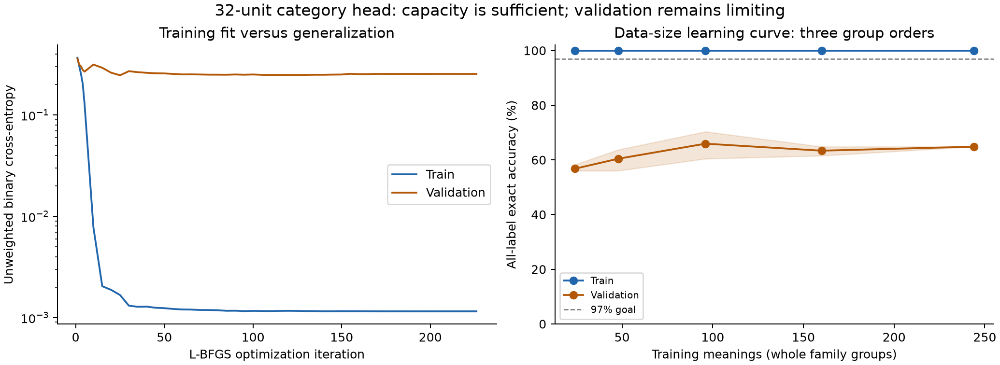
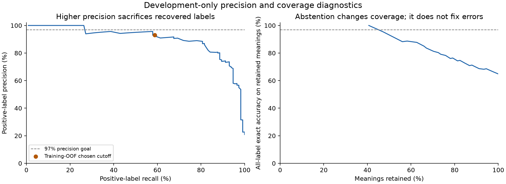

# Capacity, generalization, confidence, and training extensions

The 32-unit classifier has enough capacity for this pilot. It fits one real
24-meaning batch containing positive examples of all six categories with 100%
exact label-set accuracy. With the selected regularization its BCE is 0.000828;
with L2 removed for the capacity check it is 9.46e-8. This checks fitting ability,
not generalization. The full 244-row training set also reaches 100% exact match,
while the original 91-row validation exact match is 65.93%.

## Learning curves



All training-size fits can memorize their samples; the validation curve remains
much lower. Increasing training data improves some results but does not close
the gap. The optimization trace reaches its smallest validation BCE around
iteration 25, while later optimization continues reducing training loss. The
primary problem is generalization and confidence quality, rather than an
inability to fit training examples. Three training-group orders per size are
shown; the shaded range is not a confidence interval. A chosen early-stop point
would need a separate evaluation, so the plot does not retroactively replace
the frozen model.

## Confidence and the requested 97% target

The original validation outputs contain 21 confidently wrong binary memberships
across 16 meanings (false positives at p>=0.9 and false negatives at p<=0.1).
Examples include predicting relation for “jump” and “talk” with p>0.999.
Independent AI proposals on those 16 meanings flag seven as ambiguous under the
policy. Other disagreements also occur. This biased error-only review cannot
estimate global annotation accuracy; no held-out labels were changed.

Temperature plus one shared logit offset, fitted on training out-of-fold
predictions, improves reused-validation BCE from 0.25494 to 0.18485 and Brier
from 0.05976 to 0.05298. Temperature is 1.83131 and the offset is -0.24010.
The method was selected using validation, so this is development evidence,
not independent calibration proof. The saved candidate retains all six
probabilities. Its transported default threshold preserves the original binary
decisions. A global monotone transform does not improve the precision–recall
frontier. See the [original calibration research](https://proceedings.mlr.press/v70/guo17a.html)
for the method, not a performance guarantee for this dataset.



97% precision is different from 97% exact label-set accuracy. Micro positive-label
precision counts correct positive memberships among all emitted memberships;
recall counts recovered true memberships. Exact match requires the complete
six-label set to be right for a meaning. Bitwise accuracy counts many easy
negative memberships and is not a substitute for those measures.

Searching every distinct training-OOF score (with at least three predicted
positives in every category) chooses raw threshold 0.990877606: 97.27% OOF
precision and 57.23% recall. On validation that frozen cutoff gives only
**93.06% precision and 58.77% recall**, with five false positives among 72
positive predictions. The target does not generalize. Exploratory abstention
can retain 37/91 meanings with no exact errors in this already-seen validation
sample, but excludes 59.34% of meanings and is not evidence of 97% accuracy on
future data. All six soft probabilities remain available; hard thresholds are
operating-point diagnostics, not required adapter-routing rules.

A further fixed-width search used 64 new configurations, broad then narrowed,
with six CPU workers and training-only grouped four-fold CV. It varied L2,
positive weighting, preprocessing, and optimization budget. Three finalists
plus the preserved baseline were checked on reused validation. **None reached
97% validation precision at its training-selected cutoff.** The saved
probability-loss candidate has validation BCE 0.18035 and Brier 0.05460;
compared with the calibrated original, BCE is slightly better and Brier worse.
Its target cutoff gives 90.36% precision / 65.79% recall. It is not activated.
Full settings, capped-iteration diagnostics and results are in
[precision-search](precision-search/report.json).

## Label errors and new training data

The [frozen linear/MLP error analysis](../ERROR_ANALYSIS.md) lists validation and
test errors, per-class precision/recall/F1, and exact versus bitwise accuracy.
The original test is now descriptive/retired for model selection. State and
relation are the main weak classes. Annotation correctness itself remains
unknown without an independent, representative review.

The [training supplement](supplement/README.md) adds 57 new AI-authored meanings,
all inspected by the primary assistant after a Luna draft. Thirty-six of the
initial 60 proposals needed changes; three examples were then excluded after a
second review identified overlap with known test meanings. Original 417 rows,
labels and partitions remain frozen. The new training total is 301. The
supplement is compared with unchanged hyperparameters and thresholds, on
reused validation only; improvements and regressions are both reported.

Image crops are a separate image–meaning augmentation, described in the
[crop fixture](../../../../tests/fixtures/image-crops/README.md). They cannot
increase the text-only classifier's sample count or establish classifier gains.

## Mobile cost and reproducibility

The 512→32→6 head has 16,614 parameters and about 16,576 multiply–accumulates.
Float32 parameters and preprocessing arrays occupy about 68.9 KiB, excluding
runtime object overhead; the current JSON is larger. On this Apple M5/arm64,
2,000 cached-vector calls average 0.0267 ms (p95 0.0294 ms), excluding CLIP,
model loading and image preparation. This supports keeping the head small,
but is not a physical-phone battery or temperature measurement. No Android
device was attached. See [benchmark metadata](../mobile-head-benchmark.json).

```sh
node scripts/audit-meaning-taxonomy.mjs
node scripts/audit-meaning-supplement.mjs
node scripts/encode-meaning-taxonomy.mjs --supplement
python3 scripts/diagnose-meaning-classifier.py
python3 scripts/tune-meaning-classifier-precision.py
python3 scripts/analyze-meaning-errors.py
python3 scripts/evaluate-meaning-supplement.py
python3 scripts/plot-meaning-classifier-diagnostics.py
python3 scripts/test-meaning-classifier-diagnostics.py
node --test tests/meaningClassifierDiagnostics.test.mjs
```

Use NumPy 2.3.5 / SciPy 1.16.3 from the recorded training environment. Plotting
also requires matplotlib and its dependencies. All new selection/calibration
uses train and reused validation only, with no new test-based selection.
Neither the production classifier nor the production image ranking is changed.
