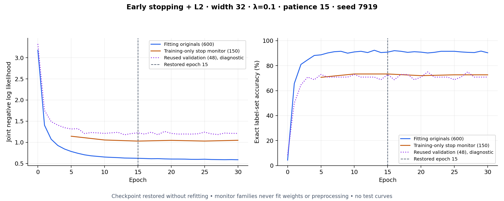

# Restore-best early stopping with L2

This applies the user's requested combination to the original-policy meaning
classifier. Both controls are enabled in the exported experimental checkpoint.
The six labels, definitions, 512-D text embeddings and source partitions remain
unchanged. All six probabilities remain available; exact label-set accuracy is
the primary metric and the target is still **more than 90%**.

The combined model improves exact accuracy and probability loss over its
matched uncontrolled fit, but does not pass the broader reference safeguards.
It does not replace the original offline reference or the compact experimental
CRF, and no image/text adapter or personal image ranker is changed.

## What is applied

- Joint head: `512 → 32 tanh → 6 unary scores`, plus 15 global pair couplings;
  exact normalization over all 64 label sets, with no dropout.
- **L2 = 0.1**: add `lambda/2 * (||W_hidden||² + ||W_output||² + ||couplings||²)`
  to the joint negative log likelihood. Hidden and unary biases are unpenalized.
  This is coupled objective L2 with Adam, not decoupled AdamW decay.
- **Early stopping**: inspect unpenalized joint NLL on a grouped training-only
  monitor every five epochs. Improvement must exceed 0.0001. Patience is 15
  epochs, execution lasts at least 30 epochs, and the ceiling is 1,000.
- **Restore the best checkpoint** after stopping or reaching the ceiling.
  The selected checkpoint is not refitted on the monitor or all available data.
- Same seeded Glorot-style random initialization, Adam learning rate 0.003,
  batch size 64 and gradient clipping norm 5 in every matched condition.

For seed 7919, the best checkpoint is **epoch 15**, restored after execution
stopped at epoch 30. Seeds104729 and 130363 restore epochs 35 and 45, respectively,
after executing 50 and 60. No epoch is chosen from validation or either test.

The old structured-head experiment already used inner-monitor epoch selection,
followed by a full-training refit. The wide double-descent diagnostic deliberately
used fixed budgets without stopping. This experiment instead retains the actual
inner-trained best checkpoint, so its validation curve and exported weights
refer to that checkpoint directly.

## Data and frozen selection

There are 890 available training rows representing 750 original meaning units.
The final fitting portion contains **716 rows: 600 original meanings and 116
paraphrases**. A separate **150 original meanings** choose stopping. Their24
paraphrases are excluded, preserving source-family isolation. Original and
paraphrase fitting rows share one unit of sampling weight. Preprocessing uses
only the fitting portion; monitor meanings do not fit weights or feature scales.

All four matched conditions use exactly these same fitting rows, reserved
monitor groups, seeds, initial weights, batch ordering and learning rate.
Without stopping, the reserved monitor is still excluded and the fit executes
1,000 epochs. This isolates the effects of early stopping and L2 within the
current comparison. Historical full-data models fitted 750 original meanings;
their metrics are not a controlled ablation of this smaller fitting portion.
The lower fitting count is intentional, not a label change.

The frozen search tests **27 settings**: widths 32/128/1,024, positive L2 values
0.0001/0.001/0.01/0.1, patience 15/30, plus three zero-L2 controls. Four outer
grouped folds rank settings on training-only predictions. The two best positive
settings per width and all three zero-L2 controls repeat three seeds, giving
**54 CV runs** (216 fits), followed by 27 final checkpoint fits. Six matched
no-stop fits and three early-stop/no-L2 fits complete the ablation.

The candidate must have positive L2. Validation ranks three-seed mean exact
accuracy, macro F1 and BCE, requiring mean and fixed-seed noninferiority margins
against the retained reference. Near-equivalent settings prefer fewer stored
tensors. No candidate qualifies; **trial 6** is retained as the best experimental
combination and explicitly marked ineligible. Seed7919 is exported consistently.
The selected settings and all matched controls freeze before test evaluation.

No post-fit calibration, label corrections, test-based seed selection, threshold
search or model substitution is performed. Validation 48 and both retired test
cohorts have been used historically. These are regression/diagnostic results,
not fresh blind confirmation. The adaptive search can overfit reused estimates.

## Matched results

Values below are means across three fixed seeds. Precision/recall are micro-averaged; F1 is macro-averaged. Every exact prediction must get all six memberships right.

### Reused validation 48

| Condition | Exact accuracy | Macro F1 | Micro precision | Micro recall | BCE ↓ | Brier ↓ | Joint NLL ↓ |
|---|---:|---:|---:|---:|---:|---:|---:|
|Neither (1,000 epochs)|70.14%|82.03%|87.52%|79.03%|0.4548|0.0623|2.6634|
|L2 only (1,000 epochs)|68.06%|77.53%|87.59%|72.04%|0.2065|0.0597|1.2315|
|Early stopping only|69.44%|83.69%|86.86%|81.72%|0.1847|0.0513|1.0991|
|Early stopping + L2|72.92%|80.19%|90.22%|74.19%|0.2017|0.0571|1.2021|

The combination raises exact accuracy by 2.78 points and substantially reduces probability loss against the uncontrolled fit. Early stopping alone has better validation F1/recall/BCE/Brier/NLL than the combination. Adding L2 therefore trades some recall and probability quality for higher exact accuracy and precision; it does not win every metric.

### Original 120 retired checks

| Condition | Exact accuracy | Macro F1 | Micro precision | Micro recall | BCE ↓ | Brier ↓ | Joint NLL ↓ |
|---|---:|---:|---:|---:|---:|---:|---:|
|Neither (1,000 epochs)|70.56%|83.16%|80.94%|86.34%|0.3958|0.0597|2.2452|
|L2 only (1,000 epochs)|75.00%|84.24%|92.49%|79.63%|0.1616|0.0428|0.9634|
|Early stopping only|75.28%|86.01%|84.70%|88.43%|0.1600|0.0445|0.9491|
|Early stopping + L2|77.50%|85.90%|93.15%|81.48%|0.1632|0.0425|0.9718|
|Prior compact CRF (fixed seed)|78.33%|85.46%|88.89%|83.33%|0.1419|0.0406|0.8240|
|Original 32-unit reference (fixed model)|72.50%|84.44%|87.50%|82.64%|0.1554|0.0450|—|

### Other 48 retired checks

| Condition | Exact accuracy | Macro F1 | Micro precision | Micro recall | BCE ↓ | Brier ↓ | Joint NLL ↓ |
|---|---:|---:|---:|---:|---:|---:|---:|
|Neither (1,000 epochs)|67.36%|80.93%|81.39%|83.61%|0.5684|0.0692|3.3456|
|L2 only (1,000 epochs)|70.83%|76.69%|89.86%|72.68%|0.2117|0.0611|1.2607|
|Early stopping only|65.28%|78.12%|80.69%|79.78%|0.2146|0.0621|1.2788|
|Early stopping + L2|70.83%|76.55%|89.35%|73.22%|0.2108|0.0602|1.2553|
|Prior compact CRF (fixed seed)|72.92%|77.35%|88.24%|73.77%|0.1830|0.0531|1.1362|
|Original 32-unit reference (fixed model)|68.75%|80.01%|87.04%|77.05%|0.2046|0.0588|—|

The fixed-seed 7919 combined checkpoint scores 77.50% exact /85.17% F1 /92.13% precision /81.25% recall on original 120, and 70.83% exact /79.10% F1 /88.46% precision /75.41% recall on other 48. Those fixed-seed values differ from the mean F1/precision/recall rows above.

The original 120 mean exact score improves70.56%→77.50% relative to the matched uncontrolled fit. Other 48 improves67.36%→70.83%, but macro F1 and recall fall. The previously selected compact CRF still has higher exact accuracy on both cohorts (78.33% and 72.92%).

The combined candidate fails macro-F1, recall, Brier and worst-class validation safeguards; the mean precision guard also fails. The retired-test comparisons fail BCE and worst-class guards against the original 32-unit reference. The >90% exact target is not met. These results do not justify activation or replacing the retained models.

## Training curve



The orange training-only monitor chooses stopping. Purple validation 48 is
observed in a fixed-epoch replay after selection, solely to draw the curve.
The vertical line is the restored checkpoint; later points show the executed
trajectory and cannot choose a different model. Replay at the selected epoch
matches every saved parameter exactly, with maximum difference **0.0**.
The source/data/model hashes, IDs, actual monitor trace and replay trace are in
[curves.json](curves.json). The figure also has a [PDF export](training-curve.pdf).

The training/monitor loss gap remains. Early stopping limits continued fitting;
L2 discourages large coefficients. Neither guarantees that unseen meanings get
the right label set, and the two controls need not improve every metric together.

## Compute and validation

The selected head has **16,629 learned coefficients** plus 1,024 preprocessing
values, approximately **68.96 KiB** in FP32. Early stopping and L2 add training
work/rules, not inference layers. Preloaded batch 1 timing is **11.30 µs** on
arm64 Apple M5, versus9.55 µs for the 16.08 KiB compact CRF in this measurement.
These float64 NumPy timings use one BLAS thread, 20 warmups and the median of
seven 100-call means, with models restored before timing. They include feature
scaling, joint normalization, marginals and MAP, and exclude CLIP, loading,
RPC/network. They are not measurements of phone battery, heat or latency.
[resources.json](resources.json) preserves repeats and storage estimates.

Python tests verify checkpoint restoration against a fixed-epoch replay,
training-only feature fitting, source-group separation, matched fitting rows,
fixed no-stop budgets and the exact L2 gradients. JavaScript independently
reproduces every reported candidate/control joint distribution, marginal and
per-class confusion count. Both curve replay and group checks pass.

Final verification: **718 JavaScript tests and 47 Python numerical/model tests
pass**, along with the web build, macOS arm64 DMG/ZIP and Android debug APK.

This work is released with KeepVocab 1.12.23, Android versionCode 73 and
service-worker cache 112023, using macOS arm64 only and an Android debug APK.

## Replay

Use the pinned dependencies in `scripts/requirements-meaning-structured.txt`
and `scripts/requirements-meaning-curves.txt`. No app runtime dependencies are
added. In an isolated copy with this experiment's frozen outputs removed:

```sh
python scripts/test-meaning-early-l2.py
python scripts/train-meaning-early-l2.py --phase select --workers 6
python scripts/train-meaning-early-l2.py --phase controls --workers 6
python scripts/train-meaning-early-l2.py --phase evaluate
python scripts/plot-meaning-early-l2.py
node --test tests/meaningEarlyL2.test.mjs
```

[Protocol](protocol.json), [trials](trials.json.gz), [selection](selection.json),
[matched controls](controls.json) and [regression report](report.json) retain
the unchanged labels and model-choice evidence. Training/selection/evaluation
refuse to overwrite frozen outputs.
