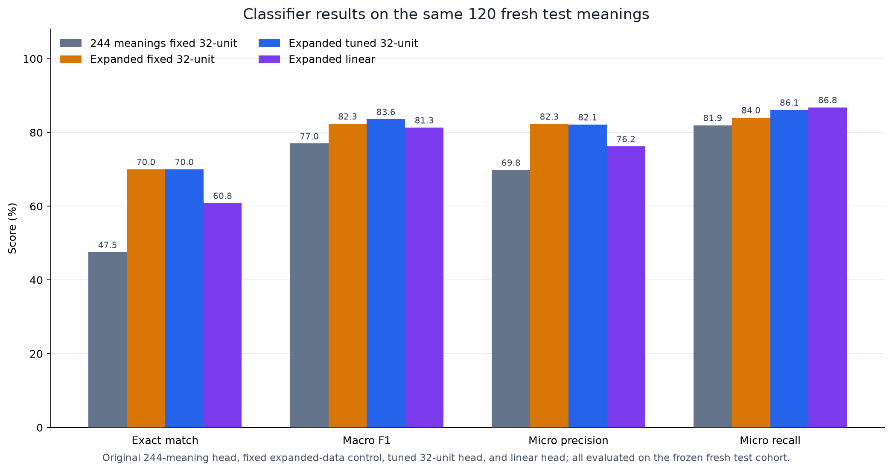

# Expanded 1,000-meaning classifier pilot

This offline pilot expands the text-meaning taxonomy and compares a regularized
linear classifier with a 32-unit multilayer perceptron (MLP). It does not
change the production classifier or image ranking. The data, grouped search,
selection, held-out evaluation, and resource measurements are recorded in the
JSON artifacts alongside this report.

## Dataset and partitions

The reviewed dataset has 1,000 meanings: 531 newly AI-authored and reviewed
meanings plus 469 active legacy meanings from the original corpus and
supplement. Five quarantined source meanings are excluded. The 531 new rows
include two meanings linked to legacy test families; those stay in the legacy
test group rather than entering fresh training or evaluation.

| Partition | Meanings | Notes |
|---|---:|---|
| Train | 590 | 301 legacy + 289 new |
| Fresh validation | 120 | New, grouped meanings |
| Fresh test | 120 | New, grouped meanings; not used for architecture or hyperparameter selection |
| Legacy validation | 91 | Frozen original validation rows |
| Legacy test | 79 | 77 frozen legacy rows + 2 new family-linked rows |
| **Total** | **1,000** | 469 active legacy + 531 new |

Training positive memberships are balanced by category:

| Category | Entity | Place | Action | State | Relation | Abstract |
|---|---:|---:|---:|---:|---:|---:|
| Positive meanings | 119 | 118 | 125 | 115 | 117 | 126 |

The category counts overlap because labels are multilabel. The saved dataset
and protocol define the groups, source records, and frozen partitions.

## Architecture search and selection

The predeclared search evaluated 82 configurations: 48 broad and 32 narrowed,
with 80 new configurations and two preserved controls. The optional 24-run
fine phase was skipped because the narrowed phase's best pooled CV F1 gain was
0.0011, below the predeclared 0.003 trigger. Architecture 32 was selected
before the fresh test was opened.

On fresh validation, the linear model failed the predeclared practical
tolerances relative to the 32-unit model on macro F1, exact match, micro
precision, and per-class F1. It passed the recall and probability-loss
tolerances. The 32-unit model was therefore selected before fresh-test scoring,
where its advantage in exact match and precision was confirmed. These tolerances are
practical decision margins, not confidence intervals or a statistical
equivalence test.

Both selected full-training fits converged (70 linear iterations and 282 MLP
iterations). Of 328 primary-search fold fits, 51 did not converge within the
optimization budget; their outcomes are retained, not claimed globally optimal.
The frozen MLP fits 98.47% of training label sets versus 65.83% on validation,
so generalization still limits it. See [fit diagnostics](fit-diagnostics.json).

## Fresh validation and test results

Precision and recall below are micro-averaged over positive category labels;
F1 is macro-averaged across the six categories. BCE and Brier are unweighted
probability losses. Thresholds were selected without using the fresh test.

| Model | Split (n=120) | Exact match | Micro precision | Micro recall | Macro F1 | BCE | Brier |
|---|---|---:|---:|---:|---:|---:|---:|
| Linear | Validation | 60.83% | 76.79% | 86.00% | 80.69% | 0.1821 | 0.0531 |
| 32-unit | Validation | 65.83% | 80.00% | 85.33% | 81.76% | 0.1745 | 0.0504 |
| Linear | Test | 60.83% | 76.22% | 86.81% | 81.30% | 0.1677 | 0.0493 |
| 32-unit | Test | 70.00% | 82.12% | 86.11% | 83.59% | 0.1564 | 0.0454 |



The most difficult test categories for the selected 32-unit model were
**relation** (support 20; precision 56%, recall 70%, F1 62.22%) and **state**
(support 20; precision 61.29%, recall 95%, F1 74.51%). State predictions were
often overinclusive, while relation remained low in both precision and recall.
Small per-class supports make these estimates sensitive to a few meanings.

## Separating data expansion from retuning

All rows in this comparison use the same 120 fresh test meanings:

| Training/control | Exact match | Macro F1 | BCE | Brier |
|---|---:|---:|---:|---:|
| Original 244-meaning, fixed 32-unit configuration | 47.50% | 76.99% | 0.4103 | 0.0920 |
| Expanded data, original configuration held fixed | 70.00% | 82.35% | 0.2277 | 0.0533 |
| Expanded data, selected/tuned 32-unit configuration | 70.00% | 83.59% | 0.1564 | 0.0454 |

The fixed-configuration result controls for retuning and shows a data-expansion
comparison on one shared fresh cohort. The tuned model adds probability-loss
improvement and a 1.24-point macro-F1 increase over that fixed expanded-data
control, with unchanged exact match. Do not compare the 70% fresh-test exact
match with the original model's 76.62% exact match on its different, retired
test cohort; the cohorts differ, so that comparison is not paired.

## The 97% precision target

The requested 97% positive-label precision target was not established. Applying
the training out-of-fold operating point to the selected 32-unit fresh test
gave 94.79% micro precision and 63.19% micro recall. The cutoff reduced recall
substantially and still missed the precision target; it does not establish a
97% operating point on future app meanings. Exact-match accuracy is a separate
measure from positive-label precision.

## Model resources

| Model | Parameters | MACs/call | FP32 weights + preprocessing | JSON bytes | Apple M5 Node mean / p95 |
|---|---:|---:|---:|---:|---:|
| Linear | 3,078 | 3,072 | 16,408 bytes | 163,605 | 0.0122 / 0.0130 ms |
| 32-unit | 16,614 | 16,576 | 70,552 bytes | 602,914 | 0.0274 / 0.0300 ms |

The linear head has about 5.4 times fewer parameters and lower cached-vector
latency, but its test exact match (60.83%) and micro precision (76.22%) trail
the selected 32-unit head (70.00% and 82.12%). Its size and speed do not make
the tested predictions interchangeable. Timings include model validation,
preprocessing and head inference on 1,000 saved vectors, with 5,000 warmups and
3,000 measured calls per model. They exclude CLIP encoding and load time. This
is an Apple M5 desktop measurement, not a phone, battery, or thermal result;
no phone measurement was performed. FP32 sizes estimate numeric payload and
exclude JavaScript object/runtime overhead.

## Limits and reproduction

Definitions and labels were AI-authored and AI-reviewed; they are not
human-expert ground truth. The fresh test is a generic balanced meaning set,
not a representative sample of actual app usage. Held-out evaluation is small,
per-class support is limited, and the predeclared practical margins do not prove
statistical equivalence. Results support an offline pilot comparison only.

Rebuild the grouped comparison figures with the recorded Python plotting
runtime (NumPy path for shared utilities and Matplotlib dependencies):

```sh
python3 scripts/plot-meaning-expanded.py
```

The script reads only `report.json` and writes `test-metrics.png` and
`test-metrics.svg` in this directory. The main reproducibility and integrity
inputs are [protocol.json](protocol.json), [selection.json](selection.json),
[report.json](report.json), [resources.json](resources.json), and the actual
expanded dataset fixture at
`tests/fixtures/meaning-taxonomy/expanded-1000/dataset.json`.

The current offline head registry is `tests/fixtures/meaning-taxonomy/current-classifier.json`.
It promotes the chosen 32-unit weights for subsequent conditioning experiments;
the existing production personal MLP is a separate model and was not replaced.

```sh
python3 scripts/prepare-meaning-expanded.py
node scripts/audit-meaning-expanded.mjs
node scripts/encode-meaning-taxonomy.mjs --expanded
python3 scripts/train-meaning-expanded.py --phase select --workers 6
# Reproduction only: the saved fresh test has now been evaluated and is retired.
python3 scripts/train-meaning-expanded.py --phase evaluate
python3 scripts/diagnose-meaning-expanded.py
node scripts/benchmark-expanded-meaning-classifier.mjs
node scripts/prepare-clip-adapter-data.mjs --classifier tests/fixtures/meaning-taxonomy/expanded-1000/classifier.json
```

Use NumPy 2.3.5 and SciPy 1.16.3, matching the original training environment.
The builder uses SciPy MILP for group stratification and refuses to overwrite
a frozen dataset if a rebuilt partition differs. A new experiment version is
required for label, source, or partition changes. No new human annotation or
real preference-learning result is claimed.
