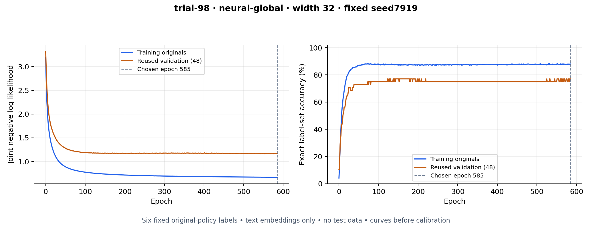

# Structured heads, larger models and training curves

Completed for KeepVocab 1.12.22. Original six-label policy v1, definitions,
512-D MobileCLIP meaning embeddings and partitions are unchanged. The primary
target is **more than 90% exact label-set accuracy per meaning**. It remains
unmet. All six membership probabilities are retained; joint MAP decoding is
used only for discrete set prediction and evaluation.

The frozen validation rule retains the previous compact calibrated CRF as the
selected experimental candidate. None of the new families passes all declared
validation safeguards. The original stronger-L2 32-unit offline reference,
production application, CLIP routing/adapters and personal preference model
are not replaced by this experiment.

## Architectures actually trained

| Family | Structure and reason to test it |
|---|---|
| Shared nonlinear joint head | 512 → tanh/ReLU hidden →6 unary scores, plus 15 global pair couplings; nonlinear features shared across labels |
| Input-conditioned pairwise head | Hidden features produce6 unary and 15 pair scores for each meaning; action/state interactions can vary with the input |
| Residual joint head | A freshly fitted linear CRF plus a nonlinear residual; test trainable and frozen linear paths, retaining an easier linear solution |
| Conditional linear/PCA head | Training-only PCA, then21 meaning-dependent unary/pair scores; a smaller learned head with explicit transform storage |
| RBF SVM reference | Six nonlinear binary margins with positive-slope Platt probabilities; deduplicated shared support dictionary, with explicit mobile storage cost |

Every joint head normalizes over all 64 label sets exactly. The SVM provides a
factorized64-state joint from its six calibrated probabilities, so its MAP is
equivalent to thresholding each probability at 0.5. No class is discarded from
the six probability outputs. These heads classify meanings, not photographs.

The residual idea is motivated by [Gorishniy et al.](https://arxiv.org/abs/2106.11959),
but this implementation is a small residual joint head rather than that paper's
exact tabular network. Conditional potentials are motivated by
[input-conditioned pairwise CRFs](https://pmc.ncbi.nlm.nih.gov/articles/PMC4410807/);
our six-label exact likelihood differs from their pseudolikelihood training.
Neither source establishes suitability or accuracy for this dataset. The SVM
uses the pinned [scikit-learn1.7 SVC API](https://scikit-learn.org/1.7/modules/generated/sklearn.svm.SVC.html)
with `probability=False`; calibration is explicit and group-isolated.

## Search and assessment

The search fits **136 configurations**:96 broad/matched capacity controls and 40
local refinements around the strongest training-CV regions. Twenty finalists,
including all ten matched width/L2 controls, repeat three seeds with an expanded
600-epoch ceiling. This produces **196 four-fold CV runs**:784 outer and 784
separate inner fits, followed by 60 full-training fits and their inner fits.
Each SVM fit has six binary learners; residual fits have additional linear warm
starts. The search/refits took128.68 seconds using six worker processes.

Training has 890 rows representing750 original meaning units;140 paraphrases
share their parent's total sampling weight. Training/CV metrics count original
meanings once. All connected source/paraphrase groups stay together. Feature
means/scales/PCA are fitted only on each current training portion. Residual
warm starts are refitted inside that portion, never copied from a full-data
model. SVM support vectors come only from its fitting rows.

Grouped inner monitors choose neural epochs by joint NLL, followed by a fresh
full-training-portion fit for that fixed number of epochs. Linear CRFs converge
by optimizer criteria. Broad/local neural CV uses one fixed inner-fitted unary
calibration; final full-data calibration uses original-training OOF predictions.
SVM Platt calibration uses inner-monitor margins for CV and training OOF margins
for final fits. Outer-fold targets never fit calibration or choose stopping.

Validation compares mean and fixed-seed 7919 results before opening the retired
tests. Selection ranks exact accuracy, then macro F1/BCE, requiring exact,
precision, recall, loss and worst-class noninferiority against the original
reference. Nearly equal candidates prefer fewer stored tensor values. A seed
with a better test score cannot replace the fixed seed afterward.

The 48 validation meanings and both test cohorts have been used historically.
They are reused selection data and retired regression checks, **not fresh blind
confirmation**. The many adaptive trials can overfit these estimates. No labels,
thresholds or model choices change after the frozen test evaluation.

## Comparison on identical labels

Rows below are the highest-validation candidate in each family, exported with
fixed seed 7919. They are retained for comparison even when validation-ineligible.
Precision and recall are micro-averaged; F1 is macro-averaged.

| Candidate | Mean validation exact | Original120 exact / F1 / precision / recall | Other48 exact / F1 / precision / recall |
|---|---:|---:|---:|
| Selected prior compact CRF |77.08%|78.33 /85.46 /88.89 /83.33%|72.92 /77.35 /88.24 /73.77%|
| Shared nonlinear, width 32 |77.78%|78.33 /83.32 /91.20 /79.17%|72.92 /74.29 /89.58 /70.49%|
| Input-conditioned pairs, width 64 |75.69%|78.33 /85.94 /89.55 /83.33%|77.08 /80.75 /90.38 /77.05%|
| Residual, width 8 |77.08%|75.83 /82.80 /86.03 /81.25%|75.00 /77.49 /90.00 /73.77%|
| Conditional linear, PCA 16 |75.00%|75.00 /79.46 /85.38 /77.08%|72.92 /75.42 /86.27 /72.13%|
| RBF SVM, PCA 128 |70.83%|74.17 /83.82 /91.94 /79.17%|75.00 /80.89 /90.38 /77.05%|

The input-conditioned head has the strongest other48 exact score among these
new comparisons, but its fixed-seed validation fails macro-F1 and worst-class
guards. The shared nonlinear head's higher mean validation exact score also
fails worst-class F1. Its selection eligibility cannot be repaired by choosing
the most favorable seed or by looking at test results. Other families fail
worst-class or broader validation margins as well.

The selected CRF is unchanged:94/120 and 35/48 complete meanings are correct.
It still fails recall/macro-F1/worst-class regression guards against the original
32-unit reference on other48; relation F1 remains30.77% versus50.00%. The new
conditional head raises other48 relation F1 to 46.15%, but that is a post-selection
diagnosis, not grounds to activate it. All class counts, BCE/Brier/NLL and
predictions are in [report.json](report.json); selected errors are in
[errors.json](errors.json).

## Learning curves and capacity



This is **trial 98, the highest-validation new neural candidate**, not the
globally selected compact CRF. It has32 tanh units, global pair couplings and
weight L2=0.1265154. Its inner monitor selected585 epochs; the full fit was then
replayed at exactly585 epochs while observing validation for plotting only.
Every replayed parameter matches the saved uncalibrated fit, with maximum
absolute difference0.0. Validation does not alter optimization or stopping.
Final calibration happens after these uncalibrated curves.

The fit reaches87.47% training-original exact accuracy and 77.08% raw validation
accuracy. Training joint NLL is 0.669 versus 1.165 validation. A more expressive
input-conditioned head reaches100% training accuracy but72.92% fixed-seed raw
validation accuracy. Both regularization/bias and generalization limits matter;
it is not correct to diagnose every model as simply too small.

[Inner stopping curves](inner-stopping-curve.png), [matched early-stopped capacity
controls](capacity-curve.png), PDFs and [raw curve evidence](curves.json) are saved.
Training curves score750 original meanings; fitting includes 890 rows. No test
data enter any curve. Seed bands are min–max ranges, not confidence intervals.

The user's additional request is tested separately in the
[wide fixed-budget double-descent experiment](double-descent/README.md):66 fits,
540–531,477 parameters, zero L2 and 0.001 L2,1,000 epochs without early stopping.
That experiment freezes its own protocol and cannot replace the earlier model
selection. It explicitly measures all 890 fitting rows when locating interpolation.

Increasing capacity can help an underfitting model and can sometimes improve
generalization beyond interpolation, as in [Belkin et al.](https://arxiv.org/abs/1812.11118).
Parameter count equal to sample count is not a universal neural interpolation
threshold: observed training fit matters. A width sweep can look for the
predicted pattern, but finite optimization, label structure, regularization and
the small reused validation set limit what it establishes.

## Compute comparison

| Preloaded head, Apple M5 | Learned coefficients | Estimated FP32 tensors | Median batch1 |
|---|---:|---:|---:|
| Selected compact CRF |3,093|16.08 KiB|8.49 µs|
| Shared nonlinear, width 32 |16,629|68.96 KiB|16.13 µs|
| Input-conditioned pairs, width 64 |34,197|137.58 KiB|17.34 µs|
| Residual, width 8 |7,245|32.30 KiB|15.22 µs|
| Conditional linear, PCA 16 |357|37.46 KiB|10.53 µs|
| RBF SVM, PCA 128 |5,185 plus support data|711.25 KiB|65.53 µs|

Storage includes preprocessing statistics, PCA and the SVM's861 distinct
support vectors; those data-derived transforms/supports are separate from
learned head coefficients. A small PCA head does not imply a small overall
stored model. Calibration is folded into structured coefficients where possible.
FP32 sizes are estimates; timings use float64 NumPy, one BLAS thread,20 warmups,
and the median of seven 100-call means. Models are restored before timing.
Preprocessing, joint normalization, marginals and MAP are included; CLIP
encoding/loading/RPC/network are excluded. These are arm64 desktop measurements,
not phone latency, heat or battery evidence. [resources.json](resources.json)
retains all timing repeats and artifact hashes.

## Zero-initialization control

Both neural weight matrices use seeded Glorot-style normal initialization in
the capacity sweep. Hidden biases and global pair couplings start at zero;
unary biases start at training-label log-odds. Zero L2 means no penalty, not
zero initialization. The residual family alone starts its nonlinear output
matrix at zero, with random hidden weights and a separately fitted linear path.

Setting both matrices and hidden biases to zero in our tanh network gives
`h=tanh(0)=0`. Then the output-weight gradient is proportional to `h`, and the
hidden-weight gradient is proportional to the zero output matrix. Both remain
zero; only input-independent label biases/global couplings can learn. More
identical inactive units cannot test a capacity effect. This is the symmetry
issue described in the [Deep Learning textbook](https://www.deeplearningbook.org/contents/optimization.html).

The [direct control](zero-initialization.json) checks widths16/32/1,024 across
three seeds for 20 full-batch gradient steps: all hidden/output matrix gradients
stay exactly zero and every input receives identical probabilities. This is an
invariance check, not a comparison of 20 steps with 1,000-epoch accuracy. With
random hidden weights and only the output matrix zero, the output gradient is
nonzero immediately and the hidden gradient becomes nonzero on the next step.
The all-zero control does not change the frozen search or capacity sweep.

## Verification and replay

Validation completed: **713 JavaScript tests and43 Python numerical/model tests**
pass; the web build, macOS arm64 DMG/ZIP and Android debug APK compile successfully.
Package1.12.22, Android versionCode72 and service-worker cache112022 record the
release. No Intel/universal build was invoked. Release artifacts carry SHA256
checksums; experiment fixtures remain offline.

Python tests check analytical gradients for global/contextual/residual heads,
tiny-batch fitting, deterministic replay, calibration folding, training-only PCA,
SVM margin export, Platt gradients and group isolation. A separate capacity
trainer matches the verified Adam update bit-for-bit. JavaScript independently
reproduces each reported64-state distribution, six marginals and confusion
counts. Source/data/model hashes and source-group IDs remain in artifacts.
The primary assistant reviewed Luna's read-only audits, including the distinction
between original-only training curves and all-row interpolation.

Use isolated dependencies from `scripts/requirements-meaning-structured.txt`
and `scripts/requirements-meaning-curves.txt`. No application runtime dependency
was added. In an isolated copy with this experiment's frozen outputs removed:

```sh
python scripts/test-meaning-structured.py
python scripts/train-meaning-structured.py --phase select --workers 6
python scripts/train-meaning-structured.py --phase evaluate
python scripts/plot-meaning-structured.py
python scripts/train-meaning-double-descent.py --workers 6 --epochs 1000
python scripts/plot-meaning-double-descent.py
python scripts/check-meaning-zero-init.py
python scripts/report-meaning-structured.py
node --test tests/meaningStructured.test.mjs
```

Selection/training refuse to overwrite frozen protocols/results. Curve rendering
and timing are post-selection diagnostics. [Protocol](protocol.json),
[trials](trials.json.gz), [OOF log probabilities](finalist-oof.json.gz),
[selection](selection.json), [regression report](report.json), and
[resource measurements](resources.json) retain the evidence.
