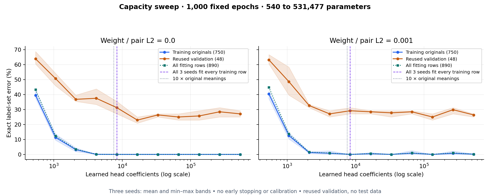
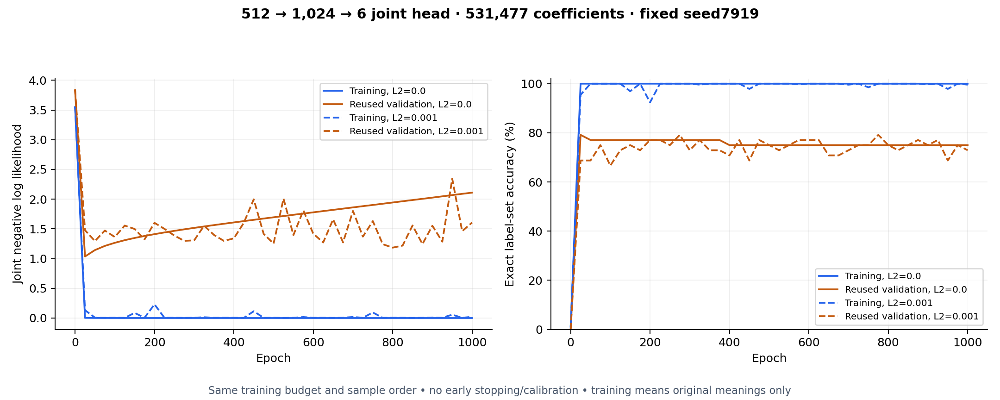

# Capacity beyond the number of training meanings

This follows the user's request to test roughly ten parameters per training
point and then increase capacity much further. It is a separate diagnostic
experiment, not another opportunity to select a model using the old tests.
The earlier structured-head selection remains frozen.

All **66 fits** use the same original-policy labels and frozen meaning vectors:
11 hidden widths × 2 L2 strengths × 3 fixed seeds. The architecture is
`512 → width tanh →6 unary scores`, plus 15 global pair couplings and exact
normalization over 64 label sets. Learned coefficients total `519×width+21`:
**540 to 531,477**, excluding 1,024 training-derived feature means/scales.

The fitting data contain890 rows representing750 independent original meaning
units, plus 140 paraphrases with shared parent weights. Width16 has 8,325 learned
coefficients:11.1 per original meaning, or 9.35 per fitted row. Width32 crosses
ten coefficients per fitted row. Width1,024 has 708.6 coefficients per original
meaning and 597.2 per fitted row. These ratios describe size; they do not establish
where a nonlinear multilabel model reaches interpolation.

Every fit gets **1,000 epochs**, with Adam learning rate 0.003, batch 64, the same
seed-dependent sample ordering and norm 5 gradient clipping. No early stopping,
dropout, post-fit calibration or threshold search is used. Compare zero weight/
pair L2 with 0.001 L2; the latter is a control, not a change to the offline model's
regularization. All features are standardized using training rows only.

We define **interpolation** as predicting the complete label set correctly for
every one of the890 fitting rows at the final epoch. Zero error on the750
original meanings alone does not satisfy that definition. Zero classification
error also does not mean zero cross-entropy/NLL. Parameter count equal to sample
count is not a universal threshold for this problem.

## Fixed final-epoch results

All values are means across three fixed seeds. Exact accuracy requires the complete label set to be correct.

| Hidden width | Learned parameters | Parameters / original meaning | All890 training exact, L2=0 | Validation exact, L2=0 | Validation exact, L2=0.001 | All-row interpolated seeds, L2=0 |
|---|---:|---:|---:|---:|---:|---:|
|1|540|0.72|56.70%|36.11%|36.81%|0/3|
|2|1,059|1.41|87.57%|49.31%|51.39%|0/3|
|4|2,097|2.80|96.55%|63.19%|67.36%|0/3|
|8|4,173|5.56|99.96%|62.50%|72.92%|2/3|
|16|8,325|11.10|100.00%|68.75%|70.83%|3/3|
|32|16,629|22.17|100.00%|77.08%|71.53%|3/3|
|64|33,237|44.32|100.00%|73.61%|72.22%|3/3|
|128|66,453|88.60|100.00%|75.00%|71.53%|3/3|
|256|132,885|177.18|100.00%|74.31%|75.00%|3/3|
|512|265,749|354.33|100.00%|71.53%|70.14%|3/3|
|1,024|531,477|708.64|100.00%|72.92%|73.61%|3/3|

All three seeds first fit every training row at width 16 (8,325 coefficients) for both regularization settings. This is an observed final-epoch result, not an assumed parameter/sample boundary. The L2 control does not interpolate in every seed at every larger width; its learning curves show occasional optimization fluctuations.

Without L2, validation exact accuracy has a small dip from 63.19% at width 4 to 62.50% at width 8, then recovers to 77.08% at width 32. That0.69-point dip is much smaller than the overlapping seed ranges. Increasing further to width 1,024 yields72.92%, despite100% fitting accuracy. The L2=0.001 maximum-width mean is73.61%, with 99.89% all-row training accuracy. No run reaches90% validation exact accuracy.

This is weak, noisy evidence compatible with several capacity effects, not a convincing classical interpolation peak followed by a sustained second descent. It also does not disprove double descent in other settings. The larger models can memorize this dataset but do not solve its generalization gap. Small-model underfitting improves as width increases; that alone is not double descent.

The largest unregularized model’s training NLL approaches zero while validation NLL rises over epochs, even when validation exact accuracy changes little. It becomes increasingly confident without making more complete meanings correct. Regularization limits that confidence growth, but the tested fixed learning rate also produces fluctuations in some regularized fits. Fixed budgets do not guarantee optimization convergence.

No identical frozen training vector has conflicting gold label sets in this input-equality check. That rules out that particular obstruction to interpolation, not ambiguous or incorrect semantic labels.

Total fitting elapsed time is 309.84 seconds using six worker processes.

## Curves and evidence

The curves show mean exact label-set error and seed min–max bands. The all-row
training series and first all-three-seed interpolation marker use890 rows;
the original-only series uses750 meanings. The dotted10× reference is a size
reference, not an assumed interpolation threshold. Min–max ranges are not
confidence intervals.

The learning curve uses the preregistered maximum width and fixed seed 7919,
for both regularization strengths. It is not a post-hoc best seed. Every size's
epoch0–1,000 trajectory is retained in [results.json.gz](results.json.gz).
Joint-NLL summaries use the shared experiment metric's probability floor1e-12;
classification errors do not use that floor. The corresponding
[capacity loss plot](capacity-loss.png) and PDF exports are also saved.

The custom fixed-budget Adam trainer matches the independently tested trainer
bit-for-bit in a numerical parity test. Protocol/data/source hashes, seeds,
IDs, parameter hashes and final maximum-width diagnostic models are preserved.
The primary assistant reviewed Luna's audit and made the all-row interpolation
definition explicit in the plot.

## What this can establish

[Belkin et al.](https://arxiv.org/abs/1812.11118) show that increasing capacity
beyond interpolation can sometimes improve generalization. To see the proposed
pattern here, held-out error would rise near observed interpolation, then fall
again at substantially larger capacity. Merely memorizing training data, adding
parameters, or finding a single favorable seed is insufficient.

The validation set contains only 48 repeatedly used meanings. A single changed
prediction moves a run by 2.08 percentage points. This is an exploratory capacity
diagnosis, not an independent verification or a proof/disproof of double-descent
theory. Finite epochs, the optimizer, hidden-layer structure and existing labels
also affect the observed curve. A wider model that fits training perfectly can
still have poor generalization.

Neither old test cohort is evaluated for this sweep. No fit is promoted, no
labels are altered, and no production/offline registry is changed. The target
of more than 90% exact accuracy requires separate confirmation; precision or
individual-label accuracy cannot substitute for it.

[Frozen protocol](protocol.json), [all run evidence](results.json.gz),
[summary](summary.json) and the [architecture comparison](../README.md) retain
the original experiment and its limitations.
